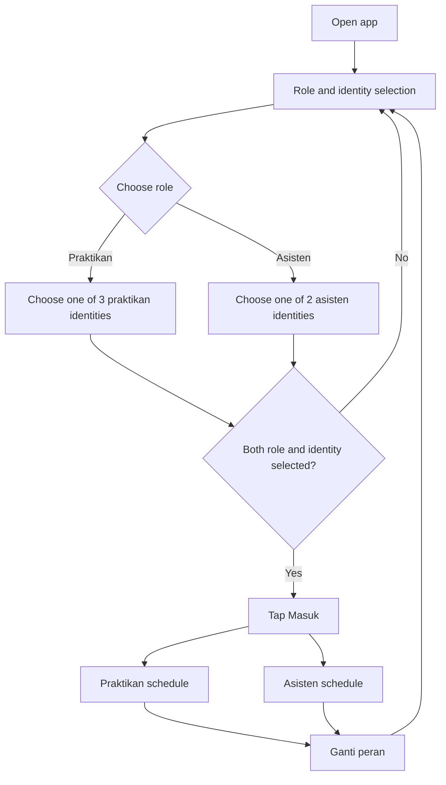
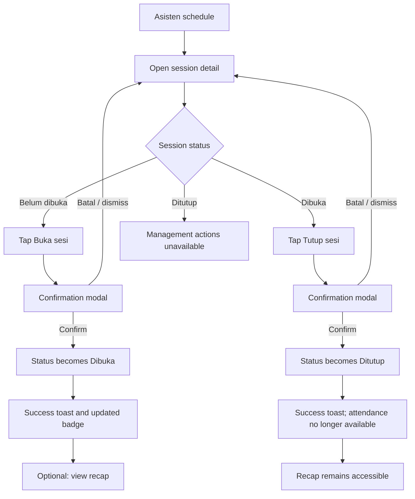
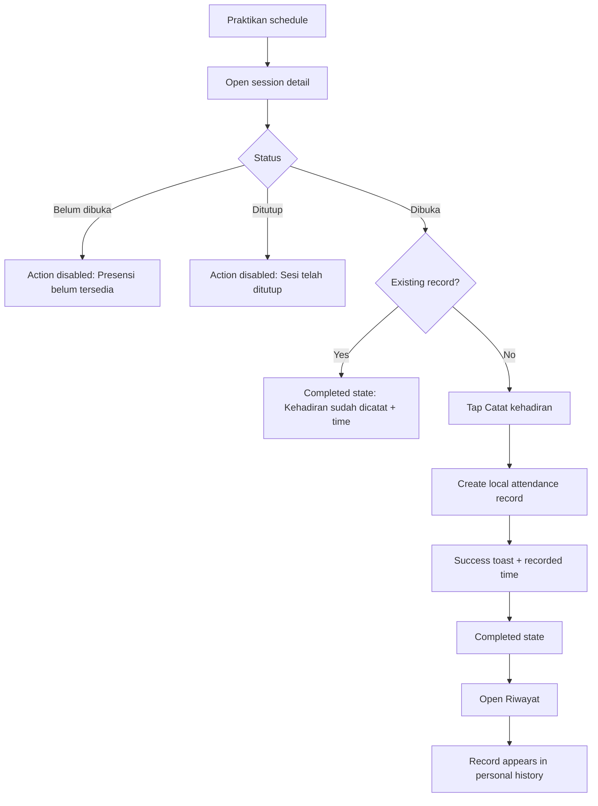
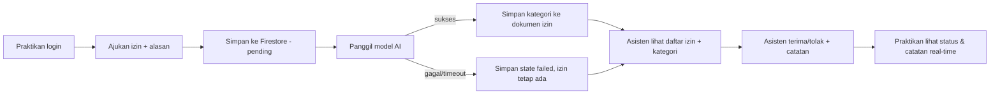
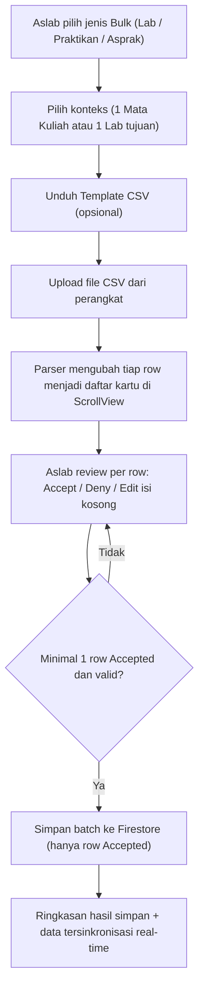
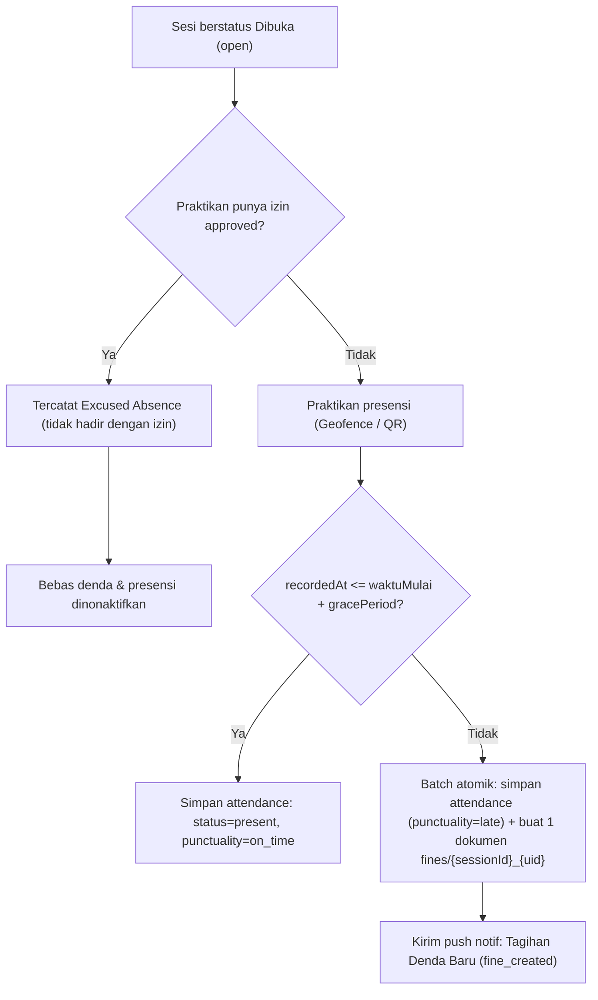
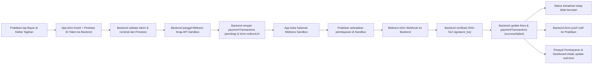

# Product Requirements Document — PrakPresensi

| Field | Value |
| --- | --- |
| Product | PrakPresensi (repository: `prak-ppk-mobile`) |
| Document version | 1.0 |
| Status | Implementation-ready specification |
| Platform | Expo / React Native (Android, iOS, web) |
| Scope | Frontend-only academic prototype |
| Source of truth | This document defines product behavior; `DESIGN.md` defines visual and interaction conventions |

---

## 6.1 Product Summary

### Product name

**PrakPresensi** — a mobile practicum attendance app for a university.

### Problem statement

Practicum attendance is often managed informally. Students do not have a clear view of when attendance is available, and assistants need a simple way to control the attendance window and inspect who has attended. For this academic project, the goal is not to replace an institutional system, but to demonstrate the complete intended experience in a small, understandable app.

### Product vision

A focused mobile utility where a praktikan can see the schedule, know whether a session is open, and record attendance in a few taps; and an asisten can open or close a session and review its attendance recap without leaving the app.

### Primary objective

Deliver a demonstrable, responsive, frontend-only React Native prototype with two roles, manual session status management, local attendance recording, duplicate prevention, and attendance recap/history.

### Target users

| User | Context | Main need |
| --- | --- | --- |
| **Praktikan** | A student attending a practicum session. | Know the schedule and session status, record attendance during an open session, and verify personal attendance history. |
| **Asisten** | A teaching assistant responsible for a practicum session. | Open/close attendance for a session and inspect the attendance recap. |
| **Evaluator/lecturer** | Reviews the app as an academic deliverable. | Follow a short, reliable demonstration of both roles without setup or backend infrastructure. |

### Success criteria

1. A new user can select a role and dummy identity and reach the relevant schedule in under one minute.
2. The assistant can open and close a session, with a confirmation step and immediately visible status change.
3. The praktikan can record attendance only while a session is open, sees a success confirmation and the recorded time, and cannot record a second time for the same session.
4. The assistant can open a recap and see the praktikan's name/identifier, status, and attendance time; an empty recap shows a clear empty state.
5. The praktikan can view personal attendance history and cannot see other students' records.
6. The main demonstration flow in §6.5 completes without errors, without a backend, and without restarting the app.
7. The UI passes the definition of done in §6.11 on a small phone screen (approximately 360 px wide) and a larger phone.

---

## 6.2 Goals and Non-Goals

### Goals

- Demonstrate the **full attendance workflow**: select identity → view session → open session → record attendance → verify recap/history → close session.
- Make session status unambiguous at all times.
- Use local dummy data and React state to simulate all behavior.
- Keep the codebase small enough for one developer to implement and explain.
- Reuse a small set of components and design tokens across both roles.
- Provide clear empty, disabled, success, and error states.

### Non-goals

- Backend APIs, databases, cloud functions, and real-time synchronization.
- Real authentication, authorization, passwords, SSO, or institutional account integration.
- Multi-device or cross-instance synchronization.
- Attendance rules based on real geolocation, biometrics, QR/NFC, or network checks.
- Student enrollment management, class administration, or assistant assignment workflows.
- Editing/deleting attendance records, reopening closed sessions, or an audit trail.
- Notifications, push messages, reminders, or calendar integration.
- Exporting, filtering, pagination, analytics, or reporting beyond a simple per-session recap.
- Dark/light theme switching UI beyond the system color scheme already handled by the starter app.
- Automated test infrastructure; verification is manual for this prototype.

### Priority principle

The required attendance workflow takes priority over optional polish. If time is limited, deliver every **Must Have** requirement in §6.4 before adding animation, icons, or extra copy.

---

## 6.3 User Stories

### Role and identity

| ID | User story |
| --- | --- |
| US-01 | As a user, I want to choose the **Praktikan** or **Asisten** role and a dummy identity so that I can experience the app from either perspective. |
| US-02 | As a demonstrator, I want to switch roles without restarting the app so that I can show both sides in one session. |

### Praktikan

| ID | User story |
| --- | --- |
| US-03 | As a praktikan, I want to view my practicum schedule so that I know when and where each session takes place. |
| US-04 | As a praktikan, I want to open a session detail so that I can see the class, time, room, assistant, and current status. |
| US-05 | As a praktikan, I want to record attendance during an open session so that my presence is documented. |
| US-06 | As a praktikan, I want clear feedback and the recorded time after attendance so that I know my action succeeded. |
| US-07 | As a praktikan, I want to be prevented from recording attendance twice for the same session so that my records stay accurate. |
| US-08 | As a praktikan, I want to view only my own attendance history so that I can verify my past records. |
| US-09 | As a praktikan, I want to understand why attendance is unavailable when a session is not open or is closed. |

### Asisten

| ID | User story |
| --- | --- |
| US-10 | As an asisten, I want to view upcoming and ongoing sessions so that I can manage the right session. |
| US-11 | As an asisten assigned to a practicum, I want to open its session after confirming so that attendance becomes available at the intended time. |
| US-12 | As an asisten assigned to a practicum, I want to close its session after confirming so that attendance is no longer accepted. |
| US-13 | As an asisten, I want to see the current status immediately after an action so that I can trust the interface. |
| US-14 | As an asisten, I want to view the attendance recap for a session so that I can inspect who attended and when. |
| US-15 | As an asisten, I want a clear empty recap state so that I can distinguish "no records" from a loading or broken screen. |

---

## 6.4 Functional Requirements

All requirements below are **Must Have** because they constitute the required demonstration. There are no Should/Could requirements that block the definition of done; optional polish is tracked separately in §6.10.

### FR-01 — Role and identity selection

| Field | Value |
| --- | --- |
| Role | Both |
| Priority | Must Have |

**Description.** The entry screen lets the user pick a role and one dummy identity for that role, then enter the app.

**Expected behavior**

- Show two clearly labeled role options: **Praktikan** and **Asisten**.
- After a role is selected, show the dummy identities for that role only.
- Show name, identifier (NIM/NIP-style), and class where relevant.
- The **Masuk** button is disabled until both a role and an identity are selected.
- On submit, store the active identity in local state and navigate to the selected role's schedule.
- The active identity is visible in the role home header (for example, the user's name).

**Acceptance criteria**

- [ ] On first launch, no role or identity is selected.
- [ ] Selecting **Praktikan** shows only the three praktikan identities; selecting **Asisten** shows only the two assistant identities.
- [ ] **Masuk** cannot be activated with a missing role or missing identity.
- [ ] If the user changes role after selecting an identity, the previous identity selection is cleared and the button is disabled until a new identity is chosen.
- [ ] Successful entry lands on the correct role's schedule screen, not on the other role's route.
- [ ] No password, email, or network request is required.

### FR-02 — Schedule list

| Field | Value |
| --- | --- |
| Roles | Praktikan, Asisten |
| Priority | Must Have |

**Description.** Both roles can view a list of practicum sessions.

**Expected behavior**

- Each list item shows practicum name, class, date, start and end time, room, assistant name, and a labeled status badge.
- On the asisten schedule, sessions assigned to the active assistant are marked **Sesi Anda** so the assistant can identify their practicums without opening each item.
- List items are ordered by session date/time, earliest upcoming first; past/closed sessions appear after upcoming/open sessions. A simple fixed order is acceptable.
- Tapping anywhere on an item opens its role-specific session detail.
- The screen shows the active user's name and role, plus an action to switch role.
- Praktikan has a visible entry point to **Riwayat** (personal attendance history).

**Acceptance criteria**

- [ ] The initial list contains the ten seeded sessions from §6.7 with the specified statuses.
- [ ] Every item displays a status text label, not only a color.
- [ ] Every item displays the assigned assistant name.
- [ ] Asisten sessions assigned to the active assistant display the **Sesi Anda** marker.
- [ ] Tapping **Praktikum Pemrograman Mobile** opens `S-01`; each item opens its matching session.
- [ ] Long practicum names wrap or truncate gracefully without overlapping the status badge or time.
- [ ] If the dataset is empty, an empty state with the title **Belum ada jadwal** is shown.
- [ ] Switching role from this screen is possible without a restart.

### FR-03 — Session details

| Field | Value |
| --- | --- |
| Roles | Praktikan, Asisten |
| Priority | Must Have |

**Description.** A detail screen provides the information needed to understand and act on a session.

**Expected behavior**

- Show practicum name, class, date, start/end time, room, assistant name, and current status.
- Show status-specific guidance:
  - `upcoming` — **Belum dibuka**: attendance is not yet available.
  - `open` — **Dibuka**: attendance is available until the assistant closes the session.
  - `closed` — **Ditutup**: attendance is no longer available.
- Praktikan sees the attendance action and their existing attendance state for that session.
- Asisten sees **Buka sesi** for an upcoming session, **Tutup sesi** for an open session, and **Lihat rekap kehadiran** for any session.
- An invalid or unknown session ID shows a not-found state with a way back; the app must not crash.

**Acceptance criteria**

- [ ] All required fields are visible for `S-01` and match the data model.
- [ ] The status badge and guidance text change with the session status.
- [ ] Asisten action labels are correct for each status: open for upcoming, close for open, no open/close action for closed.
- [ ] Praktikan never sees session-management actions.
- [ ] `Lihat rekap kehadiran` is available to the asisten regardless of status, including a closed or empty session.
- [ ] Navigating to a nonexistent ID shows **Sesi tidak ditemukan** and does not crash.

### FR-04 — Open session

| Field | Value |
| --- | --- |
| Role | Asisten |
| Priority | Must Have |

**Description.** The assistant assigned to a practicum can open an upcoming session so attendance becomes available.

**Expected behavior**

- The **Buka sesi** action is available only when the active assistant is the assigned assistant for the session's practicum.
- The **Buka sesi** action opens a confirmation modal.
- The modal names the practicum and date and explains that attendance will become available.
- Confirming updates the session status from `upcoming` to `open`.
- Canceling leaves the status unchanged.
- After confirmation, the detail screen badge and action update immediately, and a success toast is shown.
- Opening a session records an `openedAt` display timestamp.
- The action is unavailable for an already-open or closed session, and the reducer rejects invalid transitions.
- An assistant who is not assigned to the practicum can still view the session and its recap but sees no **Buka sesi** action.

**Acceptance criteria**

- [ ] An unassigned assistant cannot open the session through the UI or reducer.
- [ ] Tapping **Buka sesi** does not change state until the user confirms.
- [ ] Canceling or dismissing the modal leaves the session as **Belum dibuka**.
- [ ] Confirming changes the badge to **Dibuka**, replaces the action with **Tutup sesi**, and shows a success message.
- [ ] The session remains open after navigating back to the list and reopening the detail.
- [ ] The transition is represented in React state, not faked by static per-screen copy.
- [ ] A closed session cannot be opened again in this prototype.

### FR-05 — Close session

| Field | Value |
| --- | --- |
| Role | Asisten |
| Priority | Must Have |

**Description.** The assistant assigned to a practicum can close an open session so attendance is no longer accepted.

**Expected behavior**

- The **Tutup sesi** action is available only when the active assistant is the assigned assistant for the session's practicum.
- The **Tutup sesi** action opens a confirmation modal.
- The modal names the session and warns that attendance will no longer be accepted.
- Confirming updates the status from `open` to `closed`, stores `closedAt`, and shows a success toast.
- Canceling leaves the session open.
- Existing attendance records remain intact and the recap remains accessible.
- After closure, the praktikan's attendance action becomes unavailable and the screen explains why.
- If the underlying status is no longer `open` when the confirmation is accepted, the action is rejected with an inline or toast error and the UI refreshes to the current status.
- An assistant who is not assigned to the practicum can still view the session and its recap but sees no **Tutup sesi** action.

**Acceptance criteria**

- [ ] An unassigned assistant cannot close the session through the UI or reducer.
- [ ] Tapping **Tutup sesi** does not change state until confirmation.
- [ ] Canceling or dismissing leaves the badge as **Dibuka**.
- [ ] Confirming changes the badge to **Ditutup**, removes the close action, and shows a success message.
- [ ] Existing attendance records remain visible in the recap after closing.
- [ ] A closed session cannot accept a new record through the UI or reducer.
- [ ] Reopening a closed session is not possible.

### FR-06 — Record attendance

| Field | Value |
| --- | --- |
| Role | Praktikan |
| Priority | Must Have |

**Description.** A praktikan can record attendance for a session only while it is open.

**Expected behavior**

- The primary attendance action is available only when all are true: active role is praktikan, session exists, session status is `open`, and no record exists for the active praktikan.
- Tapping **Catat kehadiran** records attendance using the active praktikan's identity and the current local time.
- The button shows a brief pending state and is disabled while saving.
- On success, a toast confirms attendance, the button changes to a completed/disabled state, and the recorded time is displayed on the same screen.
- The new record appears in the praktikan's history.
- No confirmation modal is required for attendance; the success feedback and completed state are sufficient.

**Acceptance criteria**

- [ ] With `S-01` open, Nabila Putri can tap **Catat kehadiran** once and succeeds.
- [ ] The success toast names the session or states **Kehadiran berhasil dicatat**.
- [ ] The recorded attendance time is visible immediately and persists while the app remains open.
- [ ] The new record appears in **Riwayat** without a reload.
- [ ] With a `upcoming` or `closed` session, the action is disabled and explanatory text is shown.
- [ ] Submitting while the data layer reports the session closed produces no attendance record and an error message.

### FR-07 — Prevent duplicate attendance

| Field | Value |
| --- | --- |
| Role | Praktikan |
| Priority | Must Have |

**Description.** One praktikan can have at most one attendance record per session.

**Expected behavior**

- Before rendering the action, the UI checks for an existing `(sessionId, praktikanId)` record.
- If a record exists, the action is replaced by a completed state: **Kehadiran sudah dicatat** with the time.
- The reducer independently rejects a duplicate write and leaves the existing record unchanged.
- The duplicate rule applies per praktikan, so different praktikans may each have one record for the same session.
- Switching to another praktikan identity and back does not remove an existing record during the same app run.

**Acceptance criteria**

- [ ] After Nabila records attendance for `S-01`, the attendance button is disabled and labeled as recorded.
- [ ] A second dispatch for the same session/praktikan does not create a second record.
- [ ] The attendance recap for `S-01` contains exactly one Nabila record.
- [ ] Bagas can still record attendance for the same session (once) if it is open.
- [ ] The duplicate rule remains true after navigating away and returning to the detail screen.

### FR-08 — Attendance recap

| Field | Value |
| --- | --- |
| Role | Asisten |
| Priority | Must Have |

**Description.** An assistant can inspect attendance records for a selected session.

**Expected behavior**

- The recap is reachable from the asisten session detail.
- It shows the practicum name, session date/time, and a list of attendance records.
- Each record shows the praktikan name, student identifier, status **Hadir**, and recorded time.
- The recap shows the number of recorded attendees (for example, **2 kehadiran tercatat**).
- If no attendance exists, show an empty state: **Belum ada kehadiran** with supporting text.
- The recap does not need filtering, sorting controls, pagination, or export.
- The recap remains available for open and closed sessions.
- The asisten only sees records for the selected session; praktikans cannot access this screen.

**Acceptance criteria**

- [ ] Opening the recap for `S-02` lists Bagas Saputra and Salsabila Rahma with times 10:06 and 10:11.
- [ ] Opening the recap for `S-03` lists three records including Nabila Putri at 13:04.
- [ ] Opening the recap for `S-01` before any attendance shows **Belum ada kehadiran**.
- [ ] After Nabila records attendance for `S-01`, the recap lists exactly one Nabila record with status **Hadir** and the recorded time.
- [ ] A closed session's recap is still reachable and shows the records.
- [ ] No other-student data appears in any praktikan screen.

### FR-09 — Personal attendance history

| Field | Value |
| --- | --- |
| Role | Praktikan |
| Priority | Must Have |

**Description.** A praktikan can view their own attendance records across sessions.

**Expected behavior**

- Accessible from the praktikan schedule header via **Riwayat**.
- Lists records belonging only to the active praktikan identity.
- Each item shows practicum name, session date, status **Hadir**, and the attendance time.
- Newest record appears first.
- The count of records is shown (for example, **2 kehadiran**).
- If the identity has no records, show **Belum ada riwayat kehadiran** with guidance.
- Switching praktikan identity shows that identity's records, not a merged view.

**Acceptance criteria**

- [ ] Nabila's initial history contains her `S-03` record at 13:04.
- [ ] Bagas's initial history contains `S-02` at 10:06 and `S-03` at 13:02.
- [ ] After attendance at `S-01`, Nabila's history contains three records with the new one first.
- [ ] No asisten or other praktikan controls are present.
- [ ] An identity with no records shows the empty state.
- [ ] The screen is not reachable from asisten-only routes.

### FR-10 — Confirmation and feedback interactions

| Field | Value |
| --- | --- |
| Roles | Both |
| Priority | Must Have |

**Description.** Important actions are confirmed, and the result of every action is communicated clearly.

**Expected behavior**

- **Open session** and **close session** always use a confirmation modal.
- Attendance does not require a confirmation modal but must show immediate success feedback.
- Success feedback uses an in-app toast or inline success state, not only an OS alert.
- The modal can be dismissed with **Batal**, the backdrop, and the Android back button. The destructive/primary confirm action is clearly labeled.
- While an action is pending, the confirm button is disabled to prevent double submission.
- If an invalid transition occurs, the user sees an error message and the UI reflects the actual current state.
- Status and attendance changes are visible without a manual refresh.
- A status is never communicated by color alone; badges include text.

**Acceptance criteria**

- [ ] Open and close each present a modal naming the session.
- [ ] Canceling leaves state unchanged; confirming changes it exactly once.
- [ ] Attendance shows **Kehadiran berhasil dicatat** or equivalent toast/banner and the completed button state.
- [ ] An error is shown if the user attempts an attendance action while the session is closed.
- [ ] Double-tapping a confirm action cannot create two state transitions or two attendance records.
- [ ] Every status badge includes readable text as well as a color.

---

## 6.5 User Flows

### Flow A — Role and identity selection



### Flow B — Assistant opens and closes a session



### Flow C — Praktikan records attendance and verifies history



### Flow D — End-to-end demonstration

```mermaid
flowchart LR
    A[Select Asisten Raka] --> B[Open S-01 session detail]
    B --> C[Confirm Buka sesi]
    C --> D[Status Dibuka]
    D --> E[Switch to Praktikan Nabila]
    E --> F[Open S-01]
    F --> G[Catat kehadiran]
    G --> H[Toast + time + completed state]
    H --> I[Riwayat shows record]
    I --> J[Switch back to Asisten Raka]
    J --> K[Open S-01 recap]
    K --> L[Recap shows Nabila Hadir]
    L --> M[Confirm Tutup sesi]
    M --> N[Status Ditutup]
    N --> O[Switch to Praktikan: action disabled]
```



All role changes happen in the same running app. The shared session/attendance data is in-memory React state and resets on reload; it is not backend synchronization.

---

## 6.6 Screen Inventory

| # | Screen / component | Purpose | Role | Main content | Primary action | Secondary interactions |
| --- | --- | --- | --- | --- | --- | --- |
| 1 | **Role and identity selection** (`/`) | Choose a role and dummy user. | Both | App name, two role cards, identity list, inline demo note. | **Masuk** | Change role; select identity; read note that data is local. |
| 2 | **Praktikan schedule** (`/praktikan`) | Browse practicum sessions. | Praktikan | User greeting, count, session list with status, room/time, assistant, status legend. | Open a session. | **Riwayat**; **Ganti peran**. |
| 3 | **Praktikan session detail** (`/praktikan/session/[sessionId]`) | Understand a session and record attendance. | Praktikan | Session title, status, date/time, room, assistant, guidance, attendance state. | **Catat kehadiran** (only when open and not recorded). | Read guidance; see recorded time; go back. |
| 4 | **Praktikan attendance history** (`/praktikan/history`) | View own attendance records. | Praktikan | Count, record list, empty state. | Open a related session detail. | Go back to schedule. |
| 5 | **Asisten schedule** (`/asisten`) | Browse sessions; manage assigned ones. | Asisten | User greeting, session list with status, room/time, assistant, **Sesi Anda** marker, status legend. | Open a session. | **Ganti peran**. |
| 6 | **Asisten session detail** (`/asisten/session/[sessionId]`) | Manage assigned session status and access recap. | Asisten | Session title, status, metadata, status explanation, management actions or assignment notice. | **Buka sesi** or **Tutup sesi** when assigned. | **Lihat rekap kehadiran**; back. |
| 7 | **Attendance recap** (`/asisten/session/[sessionId]/recap`) | Inspect attendance for one session. | Asisten | Session identity, attendee count, record list, empty state. | Back to session detail. | View individual attendance times. |
| 8 | **Confirmation modal** (overlay) | Confirm opening or closing. | Asisten | Title, session name, consequence text, **Batal** / confirm. | Confirm. | Cancel, backdrop dismiss, back dismiss. |
| 9 | **Success toast / banner** (overlay) | Confirm the result of an action. | Both | Short message; auto-dismiss. | Dismiss (optional). | Accessibility announcement. |
| 10 | **Not-found state** (within session route) | Handle invalid session IDs. | Both | **Sesi tidak ditemukan**, explanation, back action. | Back to schedule. | Role switch remains available. |

The informational bottom sheet is a reusable component specified in `DESIGN.md`, but no separate screen is required. Session details are a full screen; modals are used only for confirmation.

---

## 6.7 State and Data Model

This is a **presentation/local-state model only**. It is not a backend schema, does not require persistence, and may live entirely in memory.

### Type definitions

```ts
type UserRole = 'praktikan' | 'asisten';
type SessionStatus = 'upcoming' | 'open' | 'closed';
type AttendanceStatus = 'present';

interface DemoUser {
  id: string;
  role: UserRole;
  name: string;
  identifier: string;   // NIM for praktikan, NIP-style ID for asisten
  className?: string;   // e.g. "IF-3A"
}

interface Practicum {
  id: string;
  name: string;
  className: string;
  assistantId: string;
}

interface Session {
  id: string;
  practicumId: string;
  date: string;         // display date, e.g. "2026-10-26"
  startTime: string;    // "08:00"
  endTime: string;      // "09:40"
  room: string;
  status: SessionStatus;
  openedAt?: string;    // display timestamp
  closedAt?: string;    // display timestamp
}

interface AttendanceRecord {
  id: string;
  sessionId: string;
  praktikanId: string;
  status: AttendanceStatus;
  recordedAt: string;   // display time, e.g. "08:42"
}

interface DemoState {
  activeRole: UserRole | null;
  activeUserId: string | null;
  users: DemoUser[];
  practicums: Practicum[];
  sessions: Session[];
  attendanceRecords: AttendanceRecord[];
}
```

### Dummy users

| ID | Role | Name | Identifier | Class |
| --- | --- | --- | --- | --- |
| `P-01` | Praktikan | Nabila Putri | `2211102034` | IF-3A |
| `P-02` | Praktikan | Bagas Saputra | `2211102041` | IF-3A |
| `P-03` | Praktikan | Salsabila Rahma | `2211102052` | IF-3A |
| `A-01` | Asisten | Raka Pratama | `2211101008` | — |
| `A-02` | Asisten | Dinda Maharani | `2211101015` | — |
| `A-03` | Asisten | Fajar Nugroho | `2211101022` | — |
| `A-04` | Asisten | Intan Permata | `2211101039` | — |
| `A-05` | Asisten | Bayu Setiawan | `2211101046` | — |
| `A-06` | Asisten | Citra Lestari | `2211101053` | — |

### Dummy sessions

| ID | Practicum | Class | Date | Time | Room | Assistant | Initial status |
| --- | --- | --- | --- | --- | --- | --- | --- |
| `S-01` | Praktikum Pemrograman Mobile | IF-3A | Senin, 26 Okt 2026 | 08:00–09:40 | Lab Mobile 2 | `A-01` | `upcoming` — Belum dibuka |
| `S-02` | Praktikum Basis Data | IF-3A | Selasa, 27 Okt 2026 | 10:00–11:40 | Lab Basis Data 1 | `A-02` | `open` — Dibuka |
| `S-03` | Praktikum Jaringan Komputer | IF-3A | Senin, 19 Okt 2026 | 13:00–14:40 | Lab Jaringan | `A-01` | `closed` — Ditutup |
| `S-04` | Praktikum Struktur Data | IF-3A | Rabu, 28 Okt 2026 | 15:00–16:40 | Lab Komputer 3 | `A-02` | `upcoming` — Belum dibuka |
| `S-05` | Praktikum Sistem Operasi | IF-3A | Kamis, 29 Okt 2026 | 08:00–09:40 | Lab Sistem Operasi | `A-03` | `upcoming` — Belum dibuka |
| `S-06` | Praktikum Kecerdasan Buatan | IF-3A | Kamis, 29 Okt 2026 | 10:00–11:40 | Lab Kecerdasan Buatan | `A-04` | `open` — Dibuka |
| `S-07` | Praktikum Rekayasa Perangkat Lunak | IF-3A | Jumat, 30 Okt 2026 | 13:00–14:40 | Lab RPL | `A-05` | `upcoming` — Belum dibuka |
| `S-08` | Praktikum Keamanan Informasi | IF-3A | Jumat, 30 Okt 2026 | 15:00–16:40 | Lab Keamanan | `A-06` | `closed` — Ditutup |
| `S-09` | Praktikum Pemrograman Web | IF-3A | Selasa, 20 Okt 2026 | 08:00–09:40 | Lab Web | `A-03` | `open` — Dibuka |
| `S-10` | Praktikum Analisis dan Perancangan Sistem | IF-3A | Selasa, 20 Okt 2026 | 10:00–11:40 | Lab APSI | `A-04` | `open` — Dibuka |

### Seeded attendance

| Session | Praktikan | Status | Recorded time |
| --- | --- | --- | --- |
| `S-02` | Bagas Saputra (`P-02`) | Hadir | 10:06 |
| `S-02` | Salsabila Rahma (`P-03`) | Hadir | 10:11 |
| `S-03` | Nabila Putri (`P-01`) | Hadir | 13:04 |
| `S-03` | Bagas Saputra (`P-02`) | Hadir | 13:02 |
| `S-03` | Salsabila Rahma (`P-03`) | Hadir | 13:09 |

### Session states

| Internal status | UI label | Meaning | Attendance available? | Asisten action |
| --- | --- | --- | --- | --- |
| `upcoming` | **Belum dibuka** | The session exists but attendance has not been opened. | No | **Buka sesi** |
| `open` | **Dibuka** | Attendance is currently accepted. | Yes, if no record exists | **Tutup sesi** |
| `closed` | **Ditutup** | Attendance is no longer accepted. | No | No open/close action; recap remains available |

Valid transitions in this prototype:

```
upcoming --open--> open --close--> closed
```

No other transitions are allowed. `closed` cannot return to `open`. Statuses are explicit display/behavior states and are **not** computed from the current clock. The dates are dummy values even if they are in the past or future relative to the demo day.

### State ownership

| State | Owner | Scope |
| --- | --- | --- |
| Active role and identity | Demo data provider (`useReducer`/Context) | Global for the running app; changed by role selection or **Ganti peran**. |
| Users, practicums, sessions, attendance records | Demo data provider | Shared by both role routes in the same app instance. |
| Selected role and identity on the entry form | Role selection screen | Local until **Masuk** is pressed. |
| Confirmation modal visibility and action kind | Session detail screen | Local UI state. |
| Pending/saving flag | Session detail screen | Local UI state; prevents double submission. |
| Toast visibility/message | Screen or small global feedback context | Local UI state; auto-dismisses. |
| Scroll position and route stack | Navigation | Standard Expo Router behavior. |

### Role state clarification

- The two roles do **not** have separate backends. In this prototype they read the same in-memory store so the main demonstration can show an assistant's action affecting the praktikan view within one app run.
- This is **local UI state sharing**, not synchronization. There is no persistence, polling, websocket, server, or multi-device behavior.
- Restarting the app restores the seed state.
- Access control is presentational: routes and actions are hidden/disabled by role. This is not real authorization.

### Data actions and guards

| Action | Guard | Result |
| --- | --- | --- |
| `selectIdentity(role, userId)` | User exists, role matches | Set active role and user; navigate to role home. |
| `switchRole(role, userId)` | Same as above | Replace active identity; do not reset data. |
| `openSession(sessionId, at)` | Active role is asisten; active user is the assigned assistant; session exists; status is `upcoming` | Status becomes `open`, set `openedAt`. |
| `closeSession(sessionId, at)` | Active role is asisten; active user is the assigned assistant; session exists; status is `open` | Status becomes `closed`, set `closedAt`; keep records. |
| `recordAttendance(sessionId, praktikanId, at)` | Active user is that praktikan; session exists; status is `open`; no existing `(sessionId, praktikanId)` | Append one record with status `present`. |
| `getAttendanceForSession(sessionId)` | Read-only | Records for that session, ordered by recorded time. |
| `getAttendanceForPraktikan(praktikanId)` | Read-only | That praktikan's records, newest first. |

### Duplicate attendance rule

Attendance uses a composite logical key:

```
sessionId + praktikanId
```

- The detail screen derives the button state from the presence of that key.
- The reducer checks the key again before appending.
- A duplicate attempt is a no-op and does not change the existing time.
- Different praktikan IDs can record for the same open session.
- The rule is sufficient for a single-user prototype; there is no concurrency handling beyond the reducer's synchronous guard.

---

## 6.8 Edge Cases and Empty States

| Scenario | Expected behavior |
| --- | --- |
| No schedules exist | Show **Belum ada jadwal** with supporting text. Do not show an empty white screen or a loading spinner forever. |
| Session not opened (`upcoming`) | Show **Belum dibuka** and guidance that the asisten has not opened attendance. Praktikan action is disabled. Asisten pengampu sees **Buka sesi**. |
| Session already open | Show **Dibuka**. Asisten pengampu sees **Tutup sesi**, not another open action. Praktikan may attend if not yet recorded. |
| Session closed | Show **Ditutup** and state that attendance is unavailable. Praktikan action disabled. Asisten pengampu sees no open/close action; all asisten can view the recap. |
| Asisten bukan pengampu | Show the session and recap read-only. Hide **Buka sesi** and **Tutup sesi**; explain which assistant is assigned. The reducer also rejects management actions. |
| Attendance already recorded | Replace the action with **Kehadiran sudah dicatat** and the recorded time. The button is disabled. A second write is rejected. |
| Session closes while praktikan has the detail open | On action, the reducer rejects the write; show an error toast/banner and refresh the status. Because this is a single-user local prototype, this is an unlikely but defined behavior. |
| Attendance recap is empty | Show **Belum ada kehadiran** with text such as "Kehadiran yang dicatat akan muncul di sini." Keep the session header visible. |
| Attendance history is empty | Show **Belum ada riwayat kehadiran** with guidance to attend an open session. |
| User switches role/identity | Close any open modal or toast, preserve the demo data, navigate to the new role's schedule. Do not carry configuration screens across roles. |
| Form missing or invalid selection | Keep **Masuk** disabled. Show a small inline validation message if the user attempts to submit. No crash, no navigation. |
| Active identity is lost (deep link/refresh) | Redirect to the role selection screen. Do not render role screens with a null identity. |
| Unknown `sessionId` | Show **Sesi tidak ditemukan** and a **Kembali ke jadwal** action. |
| Long practicum name | Wrap to a maximum of two lines or truncate with ellipsis; never push the badge off screen or overlap the date. Use flexible widths and `numberOfLines`. |
| Long student name | Allow two lines in recap/history; keep NIM/time readable. |
| Small screen (about 360 px) | Cards use full width; no horizontal scrolling; time and badge remain visible; buttons stretch but respect 44 px minimum touch height. |
| Large text / accessibility font scaling | Text may wrap; avoid fixed text containers; primary actions remain reachable by scrolling. |
| Keyboard visible on the entry form | The form remains scrollable and the submit button is not hidden; safe areas are respected. |
| User double-taps confirm | Pending state disables the button; only one transition is applied. |
| Role mismatch on a route | Redirect to the correct role home or role selection. Do not expose asisten controls to a praktikan. |

---

## 6.9 Non-Functional Requirements

| ID | Requirement | Acceptance criteria |
| --- | --- | --- |
| NFR-01 | Responsive mobile layout | Layout uses Flexbox, fills the screen, works at 360 px width and larger, respects safe areas, and avoids fixed-width containers. Long content wraps without overlap or horizontal scrolling. |
| NFR-02 | Accessibility and contrast | Body text and essential labels meet readable contrast (target WCAG AA, 4.5:1 for normal text). Touch targets are at least 44×44 px. Status includes a text label. Buttons expose accessible roles/labels and disabled state. |
| NFR-03 | Clear feedback | Every action has a visible result: status change, pending state, success toast/banner, or inline error. No action ends with silent uncertainty. |
| NFR-04 | Consistent navigation | Both roles use the same navigation model. Back returns to the previous screen. Role switching is available from role screens. No dead ends. |
| NFR-05 | Maintainable component structure | Shared components live outside `src/app/`; screens compose shared components. No copy-pasted duplicate button/card implementations across roles. |
| NFR-06 | Minimal dependencies | No backend/API/database, no state-management library, no UI kit, and no new dependency unless already justified and approved. Use React Native core, Expo Router, and installed Expo modules. |
| NFR-07 | Predictable local state | Reducer guards invalid session transitions and duplicate attendance. State changes are synchronous from the user's perspective. Reloading restores seed data deterministically. |
| NFR-08 | Performance | The small list (ten sessions, a handful of records) renders without noticeable delay. Avoid unnecessary re-renders and heavy animation. |
| NFR-09 | Cross-platform behavior | Android, iOS, and web targets remain usable. Use platform-safe APIs and avoid iOS-only symbols without fallbacks or text labels. |
| NFR-10 | Type safety | TypeScript strict mode passes with no errors. Domain types are shared between data, store, and screens. |
| NFR-11 | Honest prototype behavior | No screen claims real authentication, persistence, notifications, or cross-device synchronization. Demo data resets on reload and this is documented. |

---

## 6.10 Scope and Prioritization

One developer owns the whole implementation. The order below is a dependency-aware sequence, not a multi-team sprint plan.

| Step | Work | Outcome | Required? |
| --- | --- | --- | --- |
| 1 | App foundation, navigation, role/identity selection | A user can enter either role and switch later. Shared types, tokens, and demo provider skeleton exist. | Must |
| 2 | Schedule list and session detail for both roles | All seeded sessions are browsable with correct status labels and metadata. | Must |
| 3 | Assistant session management | Open/close with confirmation; status updates in state; recap entry point. | Must |
| 4 | Praktikan attendance and history | Attendance action, success feedback, recorded time, duplicate prevention, personal history. | Must |
| 5 | Attendance recap | Per-session records, count, and empty state for asisten. | Must |
| 6 | Polish, empty states, and manual testing | Long-content handling, accessibility, keyboard/safe-area checks, edge cases, typecheck/lint. | Must before demo |

Optional polish only after the required workflow works:

- Subtle press/opacity feedback and short fade transitions.
- Status legend on schedule screens.
- Info bottom sheet for extra session notes.
- Dark mode token verification (the starter already supports system color scheme).

Do not add: authentication, filtering, export, analytics, notification systems, or backend integration.

---

## 6.11 Definition of Done

The application is ready to demonstrate when all items below are true.

### Functional checks

- [ ] **Role selection:** **Masuk** is disabled until role + identity are chosen; each role opens its own schedule.
- [ ] **Role switching:** **Ganti peran** returns to selection, and a new identity can enter without restarting; attendance/session data persists within the run.
- [ ] **Schedule:** ten seeded sessions appear with name, class, date, time, room, and text status; tapping opens the matching detail.
- [ ] **Session detail:** metadata and status guidance are correct for `upcoming`, `open`, and `closed`; unknown IDs show the not-found state.
- [ ] **Open flow:** **Buka sesi** requires confirmation; cancel changes nothing; confirm changes `S-01` to **Dibuka**, updates the action, and shows success feedback.
- [ ] **Attendance success:** with `S-01` open, Nabila can record attendance once; time is visible; a toast/banner confirms success.
- [ ] **Duplicate protection:** the attendance action becomes a disabled completed state; no second record exists in history or recap; the reducer guard is present.
- [ ] **Attendance availability:** an upcoming or closed session shows a disabled action with an explanation; attempting a write through the store is rejected.
- [ ] **Recap:** asisten can open the recap for `S-02`/`S-03` and see names, identifiers, **Hadir**, and times; `S-01` initially shows **Belum ada kehadiran**; after attendance it shows one record.
- [ ] **History:** Nabila sees only her records; new attendance appears at the top; another praktikan sees different records.
- [ ] **Close flow:** **Tutup sesi** requires confirmation; cancel changes nothing; confirm changes the status to **Ditutup**, preserves records, and makes praktikan attendance unavailable.
- [ ] **Feedback:** open, close, attendance, and errors each produce visible feedback; no duplicate dispatch from double taps.
- [ ] **Role boundaries:** asisten cannot record attendance; praktikan cannot open/close or access recap; only the assigned assistant can open or close a session; no other student's history is visible.
- [ ] **Empty/edge states:** invalid selection, unknown session, empty recap, empty history, and long content all behave as specified in §6.8.

### Technical checks

- [ ] `npx tsc --noEmit` passes.
- [ ] `npm run lint` passes, or any pre-existing Expo lint setup limitation is documented.
- [ ] No unhandled promise rejections, red screen errors, or console errors during the primary flow.
- [ ] No backend, database, network request, or new unnecessary dependency is introduced.
- [ ] Design tokens and shared components are used instead of scattered raw values and duplicated role-specific components.
- [ ] The app runs on Android (emulator or device) and web; iOS is validated when a macOS environment is available.
- [ ] Safe areas, keyboard behavior, and scrolling are checked on a small screen.
- [ ] README commands match the repository and the documented demo steps work with the implemented app.

### Demo readiness

- [ ] The main flow in §6.5 completes in one running app instance without developer tools.
- [ ] The demo can be repeated by reloading the app to restore seed data.
- [ ] The presenter can explain which behavior is real local state and which is simulated dummy data.

---

## Assumptions

These assumptions are part of this PRD and should be referenced when implementing:

1. All dummy praktikans are considered enrolled in all listed sessions; there is no enrollment model or class filtering.
2. Dates and times are static display data. Session status is manual, not clock-derived.
3. Attendance has one status, **Hadir**. Absence, permission, and late statuses are out of scope.
4. Attendance time uses the device's local time and is displayed as `HH:mm` (WIB context, no timezone conversion).
5. Both roles share one in-memory demo store during a single app run. This is not persistent or cross-device synchronization.
6. The app is a single-user demonstration: there is no concurrent user simulation, optimistic update, or conflict resolution.
7. The planned UI language is Indonesian; code identifiers and documentation are in English.
8. The existing Expo starter screens and native tab layout will be replaced by the routes described here and in `DESIGN.md`.


## 7.1 Ringkasan Sprint 2

### Latar belakang
Sprint 1 menghasilkan prototipe frontend dengan data in-memory yang hilang saat aplikasi di-reload dan tidak dibagi antar perangkat. Sprint 2 mengubahnya menjadi aplikasi multi-pengguna: tiap pengguna punya akun, data tersimpan permanen di Cloud Firestore, perubahan tampil real-time, dan praktikan dapat mengajukan izin yang diklasifikasikan model AI lalu diputuskan oleh asisten.

### Tujuan utama
1. Autentikasi nyata (register, login, logout) dengan peran praktikan/asisten.
2. Seluruh data praktikum (kelas, peserta, jadwal, sesi, presensi, izin) di Firestore dengan CRUD oleh asisten.
3. Presensi terintegrasi, satu kali per praktikan per sesi, dijamin di level data (bukan hanya UI).
4. Sinkronisasi real-time melalui `onSnapshot` dan data persisten.
5. Pengajuan izin dengan klasifikasi alasan oleh model AI sebagai **informasi pendukung saja**.
6. Keputusan izin (terima/tolak) hanya oleh asisten dan terlihat oleh praktikan.
7. Validasi input, penanganan error, dan Firebase Security Rules berbasis peran.

### Non-goals Sprint 2
- Notifikasi push, ekspor laporan, analitik.
- Login sosial (Google) — tidak diwajibkan pada soal ini; email/password cukup.
- Cloud Functions / backend sendiri (tidak tersedia pada paket gratis Spark; semua logika di klien + Security Rules).
- Pelatihan ulang model AI. Model dipakai apa adanya dari repo.
- Menyetujui/menolak izin otomatis berdasarkan prediksi AI (dilarang oleh soal).

### Kriteria sukses
1. Dua alur demo pada §7.5 berjalan penuh dengan dua akun berbeda di dua perangkat/jendela.
2. Data tetap ada setelah aplikasi ditutup dan dibuka kembali; sesi login juga bertahan.
3. Percobaan akses yang melanggar peran ditolak oleh Security Rules (bisa didemokan lewat Rules Playground).
4. Semua kondisi: belum login, loading, kosong, offline, dan AI tidak merespons punya tampilan yang jelas.

---

## 7.2 User Stories Tambahan

| ID | User story |
| --- | --- |
| US-16 | Sebagai pengguna baru, saya ingin mendaftar dengan email, kata sandi, nama, NIM/NIP, dan peran. |
| US-17 | Sebagai pengguna, saya ingin login dan tetap login saat aplikasi dibuka kembali, serta dapat logout. |
| US-18 | Sebagai asisten, saya ingin menambah/melihat/mengubah/menghapus praktikum, peserta, jadwal, dan sesi. |
| US-19 | Sebagai praktikan, saya hanya melihat praktikum dan sesi yang saya ikuti. |
| US-20 | Sebagai asisten, saya ingin rekap kehadiran ter-update real-time saat praktikan presensi. |
| US-21 | Sebagai praktikan, saya ingin mengajukan izin untuk sesi tertentu dengan menuliskan alasan. |
| US-22 | Sebagai praktikan, saya ingin memantau status pengajuan izin (menunggu / diterima / ditolak) beserta catatan asisten. |
| US-23 | Sebagai asisten, saya ingin melihat daftar izin beserta alasan dan kategori hasil AI, lalu menerima atau menolak. |
| US-24 | Sebagai pengguna, saya ingin pesan error yang jelas saat login gagal, koneksi putus, atau layanan AI tidak merespons. |

---

## 7.3 Functional Requirements

Penomoran FR melanjutkan Sprint 1 (FR-01..FR-10). FR Sprint 1 yang berubah dicatat pada §7.9.

### FR-11 — Registrasi
| Field | Value |
| --- | --- |
| Role | Semua (belum login) |
| Priority | Must Have |

**Perilaku**
- Form: nama lengkap, NIM/NIP, email, kata sandi, konfirmasi kata sandi, pilihan peran (**Praktikan** / **Asisten**).
- Peran **Asisten** mewajibkan **kode undangan asisten** (disimpan di dokumen `config/registration`, dicek oleh Security Rules; lihat §7.6). Praktikan tidak memerlukan kode.
- Setelah `createUserWithEmailAndPassword` berhasil, aplikasi membuat dokumen `users/{uid}` berisi profil dan peran, lalu masuk ke beranda sesuai peran.
- Jika pembuatan dokumen profil gagal, akun Auth yang baru dibuat dihapus (rollback) agar tidak ada akun tanpa peran.

**Validasi & acceptance criteria**
- [ ] Nama tidak kosong (maks 60 karakter); NIM/NIP 8–20 digit; email berformat valid; kata sandi minimal 8 karakter dan cocok dengan konfirmasi.
- [ ] Tombol **Daftar** nonaktif sampai semua field valid; pesan error per field tampil inline.
- [ ] Email yang sudah terdaftar menampilkan "Email sudah digunakan".
- [ ] Kode undangan salah → pendaftaran asisten ditolak dengan pesan jelas; tidak ada akun yang tersisa.
- [ ] Peran tidak dapat diubah sendiri setelah dibuat (dijaga Rules).

### FR-12 — Login, logout, dan persistensi sesi
| Priority | Must Have |
| --- | --- |

- Login email + kata sandi; `onAuthStateChanged` menjadi sumber kebenaran status login.
- Auth memakai persistence AsyncStorage agar pengguna tetap login setelah aplikasi ditutup.
- Saat status auth belum diketahui → layar loading (splash), bukan layar login berkedip.
- Setelah login, profil `users/{uid}` dibaca (real-time) untuk menentukan peran dan rute.
- Logout: `signOut`, hentikan semua listener Firestore, kembali ke layar login.

**Acceptance criteria**
- [ ] Pengguna belum login yang membuka rute role mana pun diarahkan ke login.
- [ ] Praktikan yang membuka rute `/asisten/...` diarahkan ke beranda praktikan (dan sebaliknya).
- [ ] Pesan error dipetakan ke Bahasa Indonesia: `auth/invalid-credential` → "Email atau kata sandi salah", `auth/too-many-requests` → "Terlalu banyak percobaan, coba lagi nanti", `auth/network-request-failed` → "Tidak ada koneksi internet".
- [ ] Setelah logout, tombol back tidak membuka layar yang dilindungi.
- [ ] Tidak ada listener Firestore aktif setelah logout (tidak ada error `permission-denied` di console).

### FR-13 — Pengelolaan data praktikum (CRUD asisten)
| Role | Asisten (tulis), Praktikan (baca terbatas) |
| --- | --- |
| Priority | Must Have |

**Entitas yang dikelola asisten**
- **Praktikum**: nama, kelas, asisten pengampu, daftar peserta (praktikan).
- **Sesi/Jadwal**: tanggal, jam mulai–selesai, ruang, status (`upcoming`/`open`/`closed`), `openedAt`, `closedAt`.
- **Peserta**: asisten menambah/menghapus praktikan dari praktikum (memilih dari akun terdaftar berperan praktikan, dicari lewat NIM/email).

**Perilaku**
- Asisten: tambah, lihat, ubah, hapus praktikum dan sesi lewat form dengan validasi.
- Hanya asisten pengampu yang boleh mengubah/menghapus praktikum itu, mengelola pesertanya, dan membuka/menutup sesinya.
- Menghapus praktikum meminta konfirmasi dan ikut menghapus sesi di bawahnya (batch); menghapus sesi yang sudah memiliki presensi menampilkan peringatan.
- Praktikan hanya melihat praktikum yang memuat UID-nya pada daftar peserta dan sesi di dalamnya.

**Acceptance criteria**
- [ ] Asisten dapat menambah praktikum + sesi baru; langsung muncul di layar praktikan peserta tanpa reload.
- [ ] Ubah dan hapus bekerja dan tercermin real-time pada pengguna lain.
- [ ] Praktikan bukan peserta tidak melihat praktikum tersebut (dan query langsung ditolak Rules).
- [ ] Waktu selesai harus setelah waktu mulai; field wajib tidak boleh kosong; ruang maks 60 karakter.
- [ ] Aturan transisi status sesi Sprint 1 tetap: `upcoming → open → closed`, tidak bisa dibuka ulang.
- [ ] Aksi tulis menampilkan pending state, toast sukses, atau pesan error.

### FR-14 — Presensi terintegrasi
| Role | Praktikan |
| --- | --- |
| Priority | Must Have |

- Presensi disimpan di `practicums/{pid}/sessions/{sid}/attendance/{uid}` — **ID dokumen = UID praktikan**, sehingga satu praktikan hanya bisa punya satu dokumen per sesi.
- Rules hanya mengizinkan `create` jika: pemanggil adalah praktikan peserta, `request.auth.uid == uid`, sesi berstatus `open`, dan dokumen belum ada. `update` dan `delete` oleh praktikan ditolak.
- Waktu presensi memakai `serverTimestamp()` (bukan jam perangkat) dan ditampilkan sebagai `HH:mm` WIB.
- UI: tombol **Catat kehadiran** hanya aktif saat sesi `open` dan dokumen belum ada (berdasarkan listener), lalu berubah menjadi **Kehadiran sudah dicatat** + waktu.

**Acceptance criteria**
- [ ] Praktikan peserta berhasil presensi saat sesi `open`; data muncul di Firestore.
- [ ] Presensi kedua pada sesi yang sama ditolak (UI nonaktif, dan Rules menolak walau lewat klien lain).
- [ ] Presensi saat sesi `upcoming`/`closed` ditolak Rules; UI menampilkan penjelasan.
- [ ] Presensi atas nama UID lain ditolak.
- [ ] Praktikan yang punya izin `approved` pada sesi tersebut tidak dapat presensi (opsional, lihat §7.8).

### FR-15 — Sinkronisasi real-time dan persistensi
| Priority | Must Have |
| --- | --- |

- Gunakan `onSnapshot` untuk: profil pengguna, daftar praktikum, sesi, presensi sesi, izin. Listener dibuat saat layar mount dan dilepas saat unmount/logout.
- Setiap listener memiliki tiga state: `loading`, `error`, `data` (termasuk kosong).
- Pengguna melihat banner "Anda sedang offline" bila koneksi terputus; data cache tetap tampil (cache Firestore) dan perubahan ditulis ulang saat online.

**Acceptance criteria**
- [ ] Asisten membuka sesi → status praktikan berubah tanpa refresh.
- [ ] Praktikan presensi → rekap asisten bertambah real-time.
- [ ] Tutup dan buka ulang aplikasi → data dan sesi login masih ada.
- [ ] Putus koneksi → banner offline tampil; tidak crash; setelah tersambung kembali data tersinkron.

### FR-16 — Rekap kehadiran
| Role | Asisten pengampu (dan asisten lain: baca) |
| --- | --- |
| Priority | Must Have |

- Rekap per sesi memakai listener pada subkoleksi `attendance` + data peserta, menampilkan: nama, NIM, status (**Hadir** / **Izin** / **Belum hadir**), waktu.
- Ringkasan angka: hadir, izin, belum hadir dari total peserta.
- Praktikan hanya dapat membaca dokumen presensi miliknya; riwayat pribadi memakai listener dokumen per sesi (bukan query koleksi) agar sesuai dengan Security Rules.

**Acceptance criteria**
- [ ] Rekap menampilkan peserta yang belum presensi sebagai **Belum hadir** setelah sesi ditutup.
- [ ] Rekap kosong menampilkan state kosong; error baca menampilkan state error dengan tombol coba lagi.
- [ ] Praktikan tidak dapat membaca presensi praktikan lain (diuji lewat Rules).

### FR-17 — Pengajuan izin
| Role | Praktikan |
| --- | --- |
| Priority | Must Have |

- Dari detail sesi (status `upcoming` atau `open`), praktikan memilih **Ajukan izin**, mengisi alasan (10–500 karakter), lalu mengirim.
- Disimpan di `practicums/{pid}/sessions/{sid}/leaveRequests/{uid}` (satu pengajuan per praktikan per sesi; ID = UID).
- Field: `praktikanId`, `praktikanName`, `praktikanNim`, `reason`, `status` (`pending`/`approved`/`rejected`), `createdAt`, `decidedBy`, `decidedAt`, `reviewNote`. Hasil klasifikasi AI **tidak** disimpan di dokumen ini, melainkan di subkoleksi `leaveClassifications/{uid}` yang hanya dapat dibaca asisten (§7.7).
- Praktikan dapat mengubah alasan atau membatalkan selama status masih `pending`; setelah diputuskan, dokumen read-only baginya.
- Daftar **Izin Saya** menampilkan semua pengajuan beserta status dan catatan asisten, update real-time.

**Acceptance criteria**
- [ ] Alasan < 10 atau > 500 karakter ditolak validasi (klien) dan Rules.
- [ ] Pengajuan kedua untuk sesi yang sama tidak membuat dokumen baru; UI menampilkan pengajuan yang sudah ada.
- [ ] Praktikan tidak dapat menetapkan `status` selain `pending` saat membuat, dan tidak dapat mengubah `status`, `decidedBy`, `decidedAt`, `reviewNote`.
- [ ] Praktikan tidak dapat mengajukan izin pada sesi `closed`.
- [ ] Pengajuan tersimpan walaupun layanan AI gagal (lihat FR-18).

### FR-18 — Klasifikasi alasan izin oleh AI
| Role | Sistem (dipicu praktikan) |
| --- | --- |
| Priority | Must Have |
| Catatan | Menggantikan kebutuhan #6 pada soal (API AI pengajar) dengan kombinasi model dari repo + analyzer izin on-device |

- Setelah praktikan mengirim izin, aplikasi menganalisis alasan **on-device** dalam dua lapisan: (1) **analyzer izin** berbasis kata kunci (`src/services/izinAnalyzer.ts`) menentukan kategori `positif`/`netral`/`negatif` sesuai kriteria alasan izin; (2) **model-edom** dijalankan sebagai sinyal sentimen sekunder (`ai.sentiment`) dan tidak ditampilkan.
- Alasan memakai analyzer: kosakata model-edom berasal dari review EDOM sehingga tidak mengenali istilah izin ("sakit", "demam", "keluarga", "mager") dan salah mengklasifikasi alasan sah (mis. "dirawat di rumah sakit" → negatif).
- Hasil klasifikasi disimpan di subkoleksi `leaveClassifications/{uid}` (field `ai`) yang **hanya dapat dibaca asisten**; praktikan hanya boleh menulis (write-only) selama izinnya pending. Dokumen `leaveRequests` tidak memuat data AI.
- Hasil ditampilkan ke asisten sebagai **label informasi pendukung** (mis. chip "Kategori AI: Positif (75%)") dengan teks "Prediksi otomatis, bukan keputusan". Praktikan tidak melihat hasil klasifikasi.
- **Hasil AI tidak pernah mengubah `status`.** Tidak ada logika `if category == ... then approve/reject` di kode klien maupun Rules.
- Klasifikasi berjalan lokal (pure JS), tanpa server dan tanpa network call. Bila gagal: izin tetap tersimpan dengan `ai.state = "failed"`, asisten melihat "Klasifikasi AI tidak tersedia", dan tersedia tombol **Coba klasifikasi ulang** (asisten).

**Acceptance criteria**
- [ ] Alasan diklasifikasi on-device dan kategori izin muncul pada kartu izin asisten.
- [ ] Contoh: "sakit demam tinggi" → positif; "ada keperluan keluarga" → netral; "mager, gak niat datang" → negatif.
- [ ] Kegagalan klasifikasi tidak menggagalkan pengajuan; pesan jelas, tidak ada crash.
- [ ] Kategori apa pun (termasuk yang tampak "layak") tidak mengubah status otomatis.

### FR-19 — Pemeriksaan izin oleh asisten
| Role | Asisten pengampu |
| --- | --- |
| Priority | Must Have |

- Layar **Izin Masuk** menampilkan daftar pengajuan (filter sederhana: Menunggu / Diterima / Ditolak) untuk praktikum yang diampu.
- Kartu: nama, NIM, sesi, alasan lengkap, kategori AI (+ confidence bila ada), waktu pengajuan, status.
- Aksi **Terima** / **Tolak** melalui modal konfirmasi dengan kolom catatan (wajib saat menolak, maks 200 karakter).
- Keputusan menulis `status`, `decidedBy`, `decidedAt`, `reviewNote`; praktikan melihat perubahan real-time.
- Keputusan bersifat final pada Sprint ini (tidak bisa diubah kembali).

**Acceptance criteria**
- [ ] Hanya asisten pengampu yang bisa memutuskan (Rules); asisten lain hanya baca.
- [ ] Praktikan tidak bisa memutuskan izin sendiri atau izin orang lain.
- [ ] Izin `approved` tampil pada rekap sebagai **Izin**.
- [ ] Double tap pada konfirmasi tidak menghasilkan dua keputusan.

### FR-20 — Validasi, error handling, dan Security Rules
| Priority | Must Have |
| --- | --- |

- Semua input divalidasi di klien (schema sederhana) **dan** di Rules (tipe, panjang, nilai enum, field yang boleh diubah).
- Error dipetakan ke pesan manusiawi: `permission-denied`, `unavailable`, `not-found`, `already-exists`, `deadline-exceeded`, error jaringan.
- Aturan lengkap ada di `firestore.rules` (lampiran) dan dijelaskan di §7.6.

**Acceptance criteria**
- [ ] Rules diuji (Rules Playground/emulator) untuk minimal: baca lintas peran, presensi dobel, presensi saat sesi tidak open, praktikan mengubah status izin, asisten non-pengampu menulis.
- [ ] Mode produksi, bukan test mode; tidak ada `allow read, write: if true`.
- [ ] Tidak ada kunci rahasia (kunci privat/service account/token AI berhak tulis) di repository. Config Firebase web bukan rahasia, tetapi Rules wajib ketat.

---

## 7.4 Peran dan Hak Akses

| Resource | Praktikan | Asisten pengampu | Asisten lain |
| --- | --- | --- | --- |
| `users/{uid}` | baca & ubah nama sendiri (peran tidak bisa diubah) | idem; baca profil praktikan (untuk mencari peserta) | idem |
| `practicums` | baca jika peserta | CRUD | baca |
| `sessions` | baca jika peserta | CRUD + buka/tutup | baca |
| `attendance` | baca milik sendiri; **create** saat sesi open | baca semua | baca semua |
| `leaveRequests` | create/baca milik sendiri; ubah alasan saat `pending` | baca semua; putuskan | baca |

---

## 7.5 User Flow (Demo)

### Flow E — Presensi (dua akun)

```mermaid
flowchart LR
    A[Asisten login] --> B[Buka sesi - konfirmasi]
    B --> C[status open tersimpan di Firestore]
    C --> D[Praktikan login di perangkat lain]
    D --> E[Sesi tampil Dibuka tanpa refresh]
    E --> F[Catat kehadiran]
    F --> G[Dokumen attendance dibuat]
    G --> H[Rekap asisten bertambah real-time]
    H --> I[Asisten tutup sesi]
    I --> J[Tombol presensi praktikan nonaktif]
```


### Flow F — Izin


---

## 7.6 Model Data Firestore dan Security Rules

### Struktur koleksi
```
config/registration                     { asistenCode }         // tidak bisa dibaca klien
users/{uid}                             { name, identifier, email, role, createdAt, inviteCode? }
practicums/{pid}                        { name, className, assistantId, studentIds[], createdAt }
  sessions/{sid}                        { date, startTime, endTime, room, status, openedAt?, closedAt? }
    attendance/{uid}                    { praktikanId, praktikanName, praktikanNim, status:"present", recordedAt }
    leaveRequests/{uid}                 { praktikanId, praktikanName, praktikanNim, reason, status, ai{...}, createdAt, decidedBy?, decidedAt?, reviewNote? }
```
Alasan desain: ID dokumen presensi/izin = UID menjamin "satu per praktikan per sesi" tanpa query tambahan; subkoleksi memudahkan Rules memeriksa status sesi dan kepesertaan lewat `get()`.

Catatan teknis:
- Riwayat pribadi & daftar izin lintas sesi memakai **listener dokumen per sesi** (`leaveRequests/{uid}`), bukan collection-group query. Alasannya: Security Rules praktikan bergantung pada ID dokumen dan collection-group query tanpa index khusus akan ditolak. Aturan `match /{path=**}/leaveRequests/{uid}` tetap tersedia untuk masa depan (butuh index collection-group bila dipakai).
- Praktikan menampilkan praktikum dengan `where('studentIds', 'array-contains', uid)`.
- Batas query `in` 30: tidak dipakai; sesi dibaca per praktikum.

### Prinsip Rules
1. Default tolak semua.
2. Identitas dari `request.auth.uid`; peran dari `users/{uid}.role` (dibaca dengan `get()`), tidak dari data kiriman klien.
3. Presensi: `create` saja, syarat sesi `open` + peserta + ID = UID + `recordedAt == request.time`.
4. Izin: praktikan hanya boleh membuat dengan `status == 'pending'`; perubahan oleh praktikan terbatas pada `reason` & `ai` saat `pending`; keputusan hanya oleh asisten pengampu dan hanya mengubah `status`, `decidedBy`, `decidedAt`, `reviewNote`.
5. Transisi sesi hanya `upcoming → open → closed` oleh asisten pengampu.

---

## 7.7 Integrasi AI (analyzer izin + model-edom, on-device)

**Status: terintegrasi.** Kategori izin ditentukan oleh analyzer izin on-device; model-edom dari repo tetap dijalankan sebagai sinyal sentimen sekunder. Tanpa server.

### Bentuk pipeline
- **Analyzer izin** (`src/services/izinAnalyzer.ts`): normalisasi teks (huruf kecil, buang tanda baca, ekspansi kata gaul seperti `mager→malas`, `ga→tidak`, `rs→rumah sakit`), pencocokan frasa kuat/menghindar/netral, lalu keputusan deterministik.
- **model-edom** (`src/lib/model-edom/`): LinearSVC 3 kelas (`negatif`, `netral`, `positif`) dari dataset review EDOM, diekspor ke JSON dan diinferensi pure JS. Hasilnya disimpan di `ai.sentiment`, **tidak** menentukan kategori dan tidak ditampilkan.

### Makna kategori (kualitas alasan izin, bukan vonis)
| Kategori | Arti | Contoh alasan | Panduan asisten |
| --- | --- | --- | --- |
| Positif | Alasan kuat, spesifik, dapat diverifikasi | "Dirawat di rumah sakit karena demam berdarah", "anggota keluarga meninggal", "mewakili kampus lomba", "rumah kena banjir" | Prioritaskan / mudah disetujui |
| Netral | Alasan umum/ambigu | "Ada keperluan keluarga", "acara keluarga", "urusan mendadak", "kurang sehat" | Perlu klarifikasi |
| Negatif | Terindikasi menghindar | "mager, gak niat datang", "malas, mau bolos", "nongkrong", "main game sampai malam" | Tinjau lebih ketat |

Aturan keputusan: kata kuat tanpa kata menghindar → positif; kata menghindar tanpa kata kuat → negatif; keduanya muncul → netral (ambigu); tidak ada yang cocok → netral. Confidence (45–95%) mencerminkan banyaknya bukti kata kunci, bukan probabilitas statistik.

### Antarmuka di klien
```ts
// src/services/leaveClassifier.ts
export async function classifyLeaveReason(reason: string): Promise<LeaveClassification>;
```
- `category`: kategori izin (`positif`/`netral`/`negatif`), `confidence`: 0..1 dari analyzer, `model`: `"model-edom+izin-analyzer"`, `sentiment`: hasil model-edom (opsional, tidak ditampilkan).
- Kegagalan tak terduga → `state: 'failed'` tanpa melempar error; pengajuan tetap tersimpan (FR-18).

### Penyimpanan hasil
- `practicums/{pid}/sessions/{sid}/leaveRequests/{uid}`: data izin tanpa AI (praktikan & asisten dapat membaca sesuai aturan).
- `practicums/{pid}/sessions/{sid}/leaveClassifications/{uid}`: field `ai` + `updatedAt`; **read hanya untuk asisten**, praktikan boleh create/update selama izin pending (write-only), asisten pengampu boleh retry kapan pun.

### Risiko yang diakui
- Karena klasifikasi dilakukan on-device, praktikan yang memodifikasi klien dapat memalsukan isi `leaveClassifications` (mis. menulis kategori `positif`). Dampaknya terbatas karena AI hanya informasi pendukung dan tidak menentukan keputusan; hasil AI juga tidak dapat dibaca praktikan. Perbaikan yang lebih kuat (Cloud Function/server yang menulis hasil) berada di luar Sprint ini.
- Analyzer izin adalah sistem berbasis aturan kata kunci, bukan model yang dilatih pada data izin nyata. Ia transparan dan deterministik, tetapi bisa salah pada kalimat yang sangat tidak baku atau sarkastis. Confidence mencerminkan bukti kata kunci, bukan probabilitas.
- model-edom tidak dipakai untuk kategori karena domainnya review EDOM; hasil sentimennya hanya sinyal sekunder yang disimpan untuk transparansi.

---

## 7.8 Edge Cases Tambahan

| Skenario | Perilaku |
| --- | --- |
| Belum login membuka aplikasi | Layar login; rute terlindungi tidak dirender |
| Status auth/profil sedang dimuat | Splash/loading, bukan layar kosong |
| Akun Auth ada tetapi dokumen `users` tidak ada | Tampilkan error + opsi logout (jangan crash) |
| Daftar praktikum/sesi/izin kosong | State kosong dengan teks bantuan |
| Offline | Banner offline; data cache tampil; aksi tulis diberi tahu "akan disinkron saat online" atau ditolak dengan pesan jelas |
| Klasifikasi AI gagal / alasan tak dikenali model | Izin tersimpan, `ai.state = failed`, tombol coba ulang |
| Sesi ditutup saat praktikan menekan presensi | Rules menolak; UI menampilkan "Sesi telah ditutup" |
| Praktikan sudah punya izin `approved` untuk sesi | Presensi dinonaktifkan dengan penjelasan "Izin Anda sudah diterima" |
| Dua asisten mengubah sesi bersamaan | Rules/transisi menolak transisi tidak valid; UI refresh dari listener |
| Menghapus praktikum yang punya presensi | Konfirmasi dengan peringatan; hapus batch |
| Email sudah terdaftar / kata sandi lemah | Pesan inline |
| Kode undangan asisten salah | Pendaftaran gagal, tidak ada akun tersisa |

---

## 7.9 Dampak ke Kebutuhan Sprint 1

| Item Sprint 1 | Perubahan |
| --- | --- |
| FR-01 pilih role & identitas dummy | Diganti FR-11/FR-12 (register/login) |
| §6.7 data dummy | Menjadi seed script/data awal di Firestore (opsional) untuk demo |
| `useReducer` demo store | Diganti Firestore + hook listener; reducer guard dipindah ke Security Rules |
| Rekap/riwayat | Sumber data dari Firestore real-time |
| NFR-11 "honest prototype" | Diperbarui: aplikasi memakai autentikasi & penyimpanan nyata |

---

## 7.10 Non-Functional Requirements Tambahan

| ID | Requirement |
| --- | --- |
| NFR-12 | Keamanan: Rules produksi, tanpa rahasia di repo, `.env` di-ignore git, peran tidak dapat dinaikkan sendiri |
| NFR-13 | Keandalan: setiap listener & aksi tulis punya penanganan error dan state loading |
| NFR-14 | Performa: query terbatas pada data milik pengguna; hanya listener yang diperlukan layar aktif |
| NFR-15 | Maintainability: akses Firebase dibungkus di `src/services/` dan hook di `src/hooks/`; komponen UI tidak memanggil Firestore langsung |
| NFR-16 | Kuota: dirancang agar muat di paket gratis Spark (jumlah listener dan baca wajar) |
| NFR-17 | Type safety: tipe domain Sprint 1 diperluas (`uid`, `Timestamp`), `tsc --noEmit` lulus |

---

## 7.11 Rencana Kerja Project Manager (pembagian tugas)

Karena Anda berperan sebagai PM, berikut urutan kerja dan pembagian yang bisa disesuaikan jumlah anggota tim.

| Tahap | Pekerjaan | Keluaran | Bergantung pada |
| --- | --- | --- | --- |
| 0 | Setup proyek Firebase + `firebase.ts` + `.env` + Rules awal | Proyek Firebase siap, semua anggota bisa terhubung | — |
| 1 | Auth: register, login, logout, route guard, persistensi | FR-11, FR-12 | 0 |
| 2 | Layer data: tipe, service Firestore, hook `onSnapshot` | Fondasi FR-13..16 | 0, 1 |
| 3 | CRUD praktikum/sesi/peserta (asisten) | FR-13 | 2 |
| 4 | Presensi + rekap + riwayat real-time | FR-14..16 | 2, 3 |
| 5 | Pengajuan izin + adapter AI | FR-17, FR-18 | 2, repo AI siap |
| 6 | Pemeriksaan izin asisten | FR-19 | 5 |
| 7 | Security Rules final + pengujian + penanganan error | FR-20 | 3–6 |
| 8 | QA dua akun, dokumentasi README, rekaman demo | Definition of Done | semua |

Saran pembagian: (A) Auth + navigasi + Rules; (B) CRUD asisten + sesi; (C) presensi/rekap/riwayat; (D) izin + AI + pemeriksaan. Tahap 0 dikerjakan PM lebih dulu agar yang lain tidak terblokir.

---

## 7.12 Definition of Done Sprint 2

**Fungsional**
- [ ] Register/login/logout bekerja; sesi login bertahan setelah aplikasi ditutup.
- [ ] Asisten CRUD praktikum, peserta, dan sesi; praktikan hanya melihat data miliknya.
- [ ] Presensi tersimpan di Firestore, tidak bisa dobel, hanya saat sesi `open`.
- [ ] Rekap asisten berubah real-time saat praktikan presensi.
- [ ] Izin diajukan, dikategorikan model AI, diputuskan asisten, dan statusnya terlihat praktikan.
- [ ] AI mati/timeout tidak menggagalkan pengajuan; AI tidak pernah memutuskan status.
- [ ] Kondisi belum login, loading, kosong, offline, dan error semuanya tertangani.
- [ ] Flow E dan Flow F berjalan penuh dengan dua akun.

**Teknis**
- [ ] `firestore.rules` terpasang, diuji dengan skenario di FR-20.
- [ ] `npx tsc --noEmit` dan lint lulus.
- [ ] Tidak ada rahasia di repository; `.env.example` tersedia.
- [ ] README berisi cara setup Firebase, penjelasan klasifikasi AI on-device (analyzer izin + model-edom), dan langkah demo.

---

## Asumsi
1. Autentikasi memakai email/password (Google Sign-In tidak diwajibkan pada soal ini).
2. Aplikasi memakai Firebase JS SDK (modular) sehingga berjalan di Expo Go tanpa EAS build.
3. Tidak ada backend/Cloud Functions; paket Firebase Spark (gratis).
4. Kategori izin (`positif`/`netral`/`negatif`) ditentukan analyzer izin on-device; model-edom dari repo dipakai sebagai sinyal sentimen sekunder.
5. Waktu presensi memakai waktu server Firestore, ditampilkan dalam WIB.
6. Bahasa UI Indonesia; kode dan dokumentasi teknis berbahasa Inggris.

---

# 8. Sprint 4 — Manajemen Laboratorium (Aslab), Fokus Sesi Asprak, Sistem Denda & Pembayaran Midtrans (SRS & Pembagian 3 Programmer)

> **Konteks Nama Aplikasi & Basis Kode:** Aplikasi telah di-rebrand menjadi **PrakYuks** (`prak-ppk-mobile`, Expo SDK 58, React Native 0.88, Expo Router, Firebase Auth & Cloud Firestore). Dokumen bagian §8 ini berfungsi sebagai **SRS (Software Requirements Specification)** sekaligus **PRD & pembagian kerja teknis** untuk **3 Programmer** pada Sprint 4.

---

## 8.1 Ringkasan Sprint 4 & Perubahan Arsitektur Peran

### Latar belakang & koreksi pemisahan peran (Penting!)
Pada Sprint 2 dan Sprint 3, aplikasi hanya memiliki **2 peran** (`praktikan` dan `asisten`), sehingga seluruh fitur manajemen laboratorium (`src/app/asisten/labs/*`, `src/services/labService.ts`), pembuatan praktikum, dan pengaturan peserta (`studentIds`) sebelumnya diimplementasikan di dalam peran `asisten` (termasuk tab `Kelola` di `src/app/asisten/(tabs)/manage.tsx`).

Pada **Sprint 4**, struktur peran dipecah tegas menjadi **3 peran**:

| Peran (`UserRole`) | Label UI | Fokus Kewenangan di Sprint 4 |
| --- | --- | --- |
| **`aslab`** *(Role Baru)* | **Asisten Laboratorium (Aslab)** | Pemegang penuh **Manajemen Laboratorium (#1)** dan **Dashboard Keberlangsungan Laboratorium (#2)**: CRUD lab, bulk/single insert terpisah (lab per mata kuliah, praktikan, asprak), template download, preview interaktif (`ScrollView`), perpindahan praktikan & asprak/aslab antar lab, konfigurasi cakupan lokasi presensi & batasan keterlambatan + nominal denda, serta pemantauan dashboard & riwayat keuangan denda. |
| **`asisten`** *(Dipersempit)* | **Asisten Praktikum (Asprak)** | Fokus penuh pada **Pengelolaan Sesi (#3)**: melihat daftar kelas/jadwal/sesi yang menjadi tanggung jawabnya, membuka sesi, memantau & mengelola presensi praktikan (termasuk status tepat waktu/terlambat & keputusan izin *excused absence*), dan menutup sesi secara real-time. **Tidak lagi memiliki kewenangan mengelola distribusi praktikan maupun konfigurasi seluruh laboratorium.** |
| **`praktikan`** | **Praktikan** | Melihat jadwal, melakukan presensi (geofence/QR) dengan evaluasi tepat waktu vs terlambat (*grace period*), mengajukan izin, melihat daftar tagihan denda, membayar denda via **Midtrans Sandbox** melalui backend, menerima push notification transaksi/denda, dan melihat riwayat pembayaran persisten. |

### Tujuan utama Sprint 4
1. Memperkenalkan peran baru **`aslab`** dan memigrasikan seluruh manajemen laboratorium serta distribusi praktikan/asprak dari peran `asisten` ke `aslab` (UI, routing, service, dan `firestore.rules`).
2. Menyediakan **3 alur bulk/single insert terpisah** (Laboratorium per mata kuliah, Praktikan ke lab, Asprak ke lab) lengkap dengan **downloadable file template** dan **staging list interaktif berbasis `ScrollView`** (accept/deny per baris, edit & lengkapi data kosong).
3. Menyediakan fitur **perpindahan praktikan dan asprak/aslab antar laboratorium** tanpa perpindahan jadwal praktikum.
4. Menyediakan **Dashboard Keberlangsungan Laboratorium** untuk Aslab dengan filter **Hari / Minggu / Bulan**, termasuk **riwayat keuangan hasil denda**.
5. Memfokuskan peran **Asprak (`asisten`)** murni pada pelaksanaan sesi praktikum yang diampunya dengan sinkronisasi real-time ke praktikan.
6. Menerapkan **perhitungan keterlambatan berbasis *grace period***, penagihan **denda nominal tetap** (1 tagihan per kejadian keterlambatan), aturan ***excused absence*** (izin disetujui bebas denda & tidak mengubah kehadiran menjadi hadir), dan menjaga agar pembayaran denda tidak mengubah status kehadiran.
7. Mengintegrasikan pembayaran denda melalui **Midtrans Sandbox** dengan arsitektur aman **`Client (React Native) ↔ Backend Server ↔ Midtrans`** (tanpa menyimpan secret key di klien; status diverifikasi melalui callback/webhook backend).
8. Mengintegrasikan **push notification** siklus denda/pembayaran dan menyediakan **halaman Riwayat Pembayaran** yang persisten, sekaligus **finalisasi antarmuka** aplikasi secara menyeluruh.

---

## 8.2 Peta Migrasi & Refactor Kode Eksisting (Asisten → Aslab)

Sebelum/saat fitur baru dibangun, tim wajib mengeksekusi pemindahan wewenang berikut agar tidak ada fitur ganda atau celah hak akses:

| Komponen / File Eksisting | Kondisi Saat Ini (Sprint 3) | Perubahan Wajib di Sprint 4 | Penanggung Jawab |
| --- | --- | --- | --- |
| `src/types/attendance.tsx` | `UserRole = 'praktikan' \| 'asisten'` | Perluas menjadi `'praktikan' \| 'asisten' \| 'aslab'` + tambah tipe `FineDoc`, `PaymentTransaction`, `LabPolicy`, `BulkRowItem` | Programmer 1 & 2 |
| `src/app/(auth)/register.tsx` & `src/services/auth.ts` | Hanya registrasi `praktikan` & `asisten` (`asistenCode`) | Tambah opsi peran **Aslab** dengan kode undangan `config/registration.aslabCode` | Programmer 1 |
| `src/components/auth/auth-gate.tsx` & `role-guard.tsx` | Routing hanya ke `/praktikan` & `/asisten` | Tambah routing `/aslab` dan guard peran `'aslab'` | Programmer 1 |
| `src/app/asisten/labs/*` | CRUD lokasi lab dimiliki `asisten` | **Pindahkan** ke `src/app/aslab/labs/*` (dan perkaya dengan mata kuliah, grace period, nominal denda); **hapus** rute tulis lab dari `/asisten` | Programmer 1 |
| `src/app/asisten/(tabs)/manage.tsx` & `_layout.tsx` | Asisten punya tombol tambah praktikum, kelola peserta, dan kelola lokasi lab | Cabut manajemen lab & distribusi peserta dari `asisten`; fokuskan `asisten` pada daftar kelas/jadwal/sesi yang diampu (lihat `FR-S4-P2-01`) | Programmer 2 |
| `src/app/asisten/practicum/*` | Asisten bisa CRUD praktikum & tambah/hapus `studentIds` | Ubah menjadi **read-only** bagi `asisten` (hanya melihat kelas, peserta, & mengelola sesi di bawahnya); manajemen praktikum & distribusi peserta (`studentIds`, `assistantId`) dipindah ke `/aslab` | Programmer 1 & 2 |
| `firestore.rules` | `laboratorium` boleh ditulis `isAsisten()`; `practicums` CRUD oleh `isAsisten()` | Ubah write `laboratorium` & distribusi peserta/asprak di `practicums` **hanya `isAslab()`**; tambah aturan ketat koleksi `fines` & `paymentTransactions` | Programmer 1, 2, 3 |
| `src/components/ui/tab-screen.tsx` | Avatar header hanya mengarah ke `/asisten/profile` & `/praktikan/profile` | Tambah dukungan `profile?.role === 'aslab'` → `/aslab/profile` | Programmer 1 |

---

## 8.3 Matriks Pembagian Tugas (3 Programmer)

Pembagian dirancang agar **beban setara**, **batas kepemilikan file jelas** (minim konflik merge), dan **alur integrasi terstruktur**:

| Ticket ID | Modul & Fitur Utama | Assignee | Estimasi (SP) | Dependensi | Saran Branch |
| --- | --- | :---: | :---: | :---: | --- |
| **FR-S4-P1-01** | Fondasi Role `aslab`, Auth, Routing & Security Rules Lab | **Programmer 1** | 3 | — | `feat/s4-p1-aslab-role-foundation` |
| **FR-S4-P1-02** | Migrasi & CRUD Laboratorium + Set Cakupan Lokasi & Batas Keterlambatan/Denda | **Programmer 1** | 5 | FR-S4-P1-01 | `feat/s4-p1-lab-management` |
| **FR-S4-P1-03** | Downloadable Templates & 3 Modul Bulk/Single Insert Terpisah (Lab, Praktikan, Asprak) | **Programmer 1** | 5 | FR-S4-P1-02 | `feat/s4-p1-bulk-insert-templates` |
| **FR-S4-P1-04** | Interactive Bulk Staging List (`ScrollView`: Accept/Deny, Inline Edit & Validasi) | **Programmer 1** | 5 | FR-S4-P1-03 | `feat/s4-p1-bulk-review-scrollview` |
| **FR-S4-P1-05** | Perpindahan (Transfer) Praktikan & Asprak/Aslab Antar Laboratorium | **Programmer 1** | 3 | FR-S4-P1-02 | `feat/s4-p1-lab-transfer` |
| **FR-S4-P2-01** | Refactor & Fokus Ruang Kerja Asprak (`asisten`) Khusus Pengelolaan Sesi | **Programmer 2** | 5 | FR-S4-P1-01 | `feat/s4-p2-asprak-session-focus` |
| **FR-S4-P2-02** | Dashboard Keberlangsungan Laboratorium & Keuangan Denda (Filter Hari/Minggu/Bulan) | **Programmer 2** | 5 | FR-S4-P1-02, FR-S4-P2-03 | `feat/s4-p2-aslab-dashboard` |
| **FR-S4-P2-03** | Mesin Perhitungan Keterlambatan (*Grace Period*) & Pembuatan Tagihan Denda | **Programmer 2** | 5 | FR-S4-P1-02 | `feat/s4-p2-late-fine-engine` |
| **FR-S4-P2-04** | Aturan *Excused Absence* (Izin Bebas Denda) & Immutabilitas Status Kehadiran | **Programmer 2** | 3 | FR-S4-P2-03 | `feat/s4-p2-excused-absence-rules` |
| **FR-S4-P3-01** | Backend Pembayaran Midtrans Sandbox (Create Transaction + Webhook Verifier) | **Programmer 3** | 5 | FR-S4-P2-03 | `feat/s4-p3-midtrans-backend` |
| **FR-S4-P3-02** | Layar Tagihan Denda & Alur Pembayaran Midtrans di Aplikasi Praktikan | **Programmer 3** | 5 | FR-S4-P3-01 | `feat/s4-p3-praktikan-fine-payment` |
| **FR-S4-P3-03** | Integrasi Push Notification Siklus Denda & Pembayaran | **Programmer 3** | 3 | FR-S4-P3-01, FR-S4-P2-03 | `feat/s4-p3-payment-notifications` |
| **FR-S4-P3-04** | Riwayat Pembayaran Persisten & Finalisasi Antarmuka Lintas Peran | **Programmer 3** | 5 | FR-S4-P3-02 | `feat/s4-p3-payment-history-ui-polish` |

**Ringkasan Distribusi Beban:**
- **Programmer 1 (21 SP):** Domain **Aslab & Manajemen Laboratorium** — Role baru `aslab`, migrasi lab dari `asisten`, single/bulk insert terpisah + template download, staging `ScrollView` interaktif, dan transfer praktikan/asprak antar lab.
- **Programmer 2 (18 SP):** Domain **Operasional Sesi, Dashboard & Mesin Denda** — Refactor peran `asisten` khusus sesi (#3), Dashboard Keberlangsungan Lab + Keuangan Denda (#2), mesin *grace period* & pencatatan tagihan denda (#4), serta aturan *excused absence*.
- **Programmer 3 (18 SP):** Domain **Payment Gateway, Notifikasi & UI Finalisasi** — Backend Midtrans Sandbox + webhook (#5), layar bayar praktikan (#5), push notification denda/pembayaran (#6), halaman Riwayat Pembayaran persisten (#6), dan finalisasi antarmuka modern/konsisten lintas 3 peran.

---

## 8.4 Spesifikasi Kebutuhan Fungsional (SRS / FR) per Programmer

### 👨‍💻 Programmer 1 — Role `Aslab` & Manajemen Laboratorium (Kebutuhan #1)

#### `FR-S4-P1-01` — Fondasi Role `aslab`, Autentikasi & Routing Terpisah
| Field | Value |
| --- | --- |
| Role | Semua (belum login), `aslab` |
| Priority | Must Have |
| Target Files | `src/types/attendance.tsx`, `src/app/(auth)/register.tsx`, `src/services/auth.ts`, `src/components/auth/auth-gate.tsx`, `src/components/auth/role-guard.tsx`, `src/components/ui/tab-screen.tsx`, `src/components/ui/app-tab-bar.tsx`, `src/app/aslab/_layout.tsx`, `src/app/aslab/(tabs)/_layout.tsx`, `firestore.rules` |

**Deskripsi.** Memperkenalkan peran ke-3 yaitu **Asisten Laboratorium (`aslab`)** dengan alur registrasi, autentikasi, route guard, dan shell navigasi tab tersendiri (`/aslab`).

**Yang harus diimplementasikan:**
1. Perluas `UserRole` menjadi `'praktikan' | 'asisten' | 'aslab'`.
2. Tambah pilihan peran **Aslab** pada `RoleCard` di layar registrasi, dengan validasi kode undangan `config/registration.aslabCode` di `firestore.rules`.
3. Perbarui `AuthGate`, `RoleGuard`, dan `TabScreen` agar `aslab` otomatis diarahkan ke `/aslab`, tidak bisa mengakses rute tulis milik `praktikan`, dan ikon avatar header mengarah ke `/aslab/profile`.
4. Siapkan layout tab `src/app/aslab/(tabs)/_layout.tsx` berisi: **Dashboard** (`index`), **Lab** (`labs`), **Peta** (`maps`), **Profil** (`profile`).
5. Tambahkan helper `isAslab()` pada `firestore.rules`.

**Acceptance Criteria:**
- [ ] Pengguna dapat mendaftar sebagai `aslab` hanya dengan `aslabCode` yang benar; kode salah ditolak Rules dan akun Auth di-rollback.
- [ ] Login sebagai `aslab` langsung masuk ke `/aslab` (Dashboard), login sebagai `asisten` ke `/asisten`, login sebagai `praktikan` ke `/praktikan`.
- [ ] Pengguna `praktikan` atau `asisten` yang mencoba membuka `/aslab/*` langsung dialihkan ke beranda perannya masing-masing.

---

#### `FR-S4-P1-02` — Migrasi & CRUD Laboratorium + Kebijakan Lokasi & Keterlambatan
| Field | Value |
| --- | --- |
| Role | `aslab` (tulis & baca), `asisten` & `praktikan` (baca terbatas) |
| Priority | Must Have |
| Target Files | `src/app/aslab/(tabs)/labs.tsx`, `src/app/aslab/labs/form.tsx`, `src/app/aslab/labs/[labId].tsx`, `src/services/labService.ts`, `src/hooks/use-laboratories.ts`, `firestore.rules` |

**Deskripsi.** Memindahkan seluruh pengelolaan laboratorium yang sebelumnya ada di `src/app/asisten/labs/` ke peran `aslab`, serta melengkapinya dengan **mata kuliah**, **cakupan lokasi presensi**, **batasan keterlambatan (*grace period*)**, dan **nominal denda tetap**.

**Yang harus diimplementasikan:**
1. Pindahkan fitur daftar, tambah (single insert), ubah, dan hapus laboratorium ke rute `/aslab/labs/*` (hapus `src/app/asisten/labs/*`).
2. Perluas form & model `laboratorium/{labId}` agar mencakup:
   - `courseName` (mata kuliah yang menjadi tanggung jawab lab/kelas tersebut)
   - `nama` (nama laboratorium / kelas lab, maks 100 karakter)
   - `gedung` / lokasi (maks 100 karakter)
   - `latitude` & `longitude` (termasuk tombol *"Gunakan Lokasi Saya Saat Ini"*)
   - `radius_meter` — **cakupan lokasi presensi** (1–1000 meter)
   - `grace_period_minutes` — **batasan keterlambatan waktu** (bilangan bulat 0–120 menit; default mis. `15` menit)
   - `late_fine_amount` — **nominal denda tetap** per kejadian keterlambatan (Rupiah, mis. `5000`, `10000`, `>= 0`)
   - `managedByAslabId` (UID aslab penanggung jawab), `assistantIds[]` (daftar UID asprak ditugaskan), `studentIds[]` (daftar UID praktikan peserta), `updated_at`.
3. Perbarui `firestore.rules` pada `match /laboratorium/{labId}`: `allow create, update, delete: if isAslab();` (cabut hak tulis dari `isAsisten()`).
4. Jaga kompatibilitas ke belakang dengan `practicums/{pid}` (atau tautkan `practicums/{pid}.labId` ke `laboratorium/{labId}`) agar peta (`FR-P1-03`), presensi geofence (`FR-P1-02`), dan sesi tetap berjalan tanpa error.

**Acceptance Criteria:**
- [ ] Aslab dapat menambah, melihat, mengubah, dan menghapus laboratorium beserta koordinat, radius presensi, durasi toleransi keterlambatan, dan nominal denda.
- [ ] Perubahan `radius_meter`, koordinat, `grace_period_minutes`, atau `late_fine_amount` langsung tersinkronisasi real-time ke peta, layar presensi praktikan, dan mesin denda.
- [ ] Asprak (`asisten`) tidak dapat membuat, mengubah, atau menghapus dokumen `laboratorium` baik dari UI maupun langsung melalui Firestore Rules (`permission-denied`).

---

#### `FR-S4-P1-03` — Downloadable Template & 3 Modul Bulk/Single Insert Terpisah
| Field | Value |
| --- | --- |
| Role | `aslab` |
| Priority | Must Have |
| Target Files | `src/lib/bulk-templates.ts`, `src/lib/bulk-parser.ts`, `src/app/aslab/bulk/labs.tsx`, `src/app/aslab/bulk/praktikan.tsx`, `src/app/aslab/bulk/asprak.tsx` |

**Deskripsi.** Menyediakan **3 fitur bulk/single insert yang dipisah secara tegas** (bukan satu file/form gabungan), masing-masing dilengkapi **file template yang dapat diunduh** oleh Aslab.

**Aturan Wajib (sesuai soal Sprint 4):**
- **Tiga alur bulk insert WAJIB terpisah:**
  1. **Bulk / Single Insert Laboratorium (per satu mata kuliah):** Aslab memilih/mengisi **satu mata kuliah** terlebih dahulu, lalu membuat sejumlah laboratorium sekaligus (mis. Lab A, Lab B, Lab C) untuk mata kuliah tersebut.
  2. **Bulk / Single Insert Praktikan ke Laboratorium tertentu:** Aslab memilih **satu laboratorium tujuan**, lalu memasukkan satu atau banyak praktikan (berdasarkan NIM/email akun terdaftar) ke laboratorium tersebut.
  3. **Bulk / Single Insert Asprak (`asisten`) ke Laboratorium tertentu:** Aslab memilih **satu laboratorium tujuan**, lalu memasukkan satu atau banyak asprak (berdasarkan NIP/email akun terdaftar berperan `asisten`) ke laboratorium tersebut.
- **Downloadable File Template:**
  - Setiap layar bulk menyediakan tombol **"Unduh Template (.csv)"** (menggunakan `expo-file-system` + `expo-sharing` di mobile dan blob download di web; instal paket Expo kompatibel via `npx expo install`).
  - Format kolom tiap template didefinisikan jelas pada §8.5.2.
- **Pemilihan & Parsing File:**
  - Gunakan `expo-document-picker` untuk memilih file `.csv` (dan opsional `.xlsx` jika dibutuhkan) dari perangkat, lalu parsing seluruh baris ke array staging object untuk diserahkan ke `FR-S4-P1-04`.
- **Single Insert tetap tersedia** di layar yang sama (tombol/tab "Tambah Satuan" vs "Import Bulk").

**Acceptance Criteria:**
- [ ] Terdapat 3 pintu masuk & layar terpisah: (1) Insert Laboratorium per Mata Kuliah, (2) Insert Praktikan ke Lab, (3) Insert Asprak ke Lab — tidak digabung dalam satu form/template.
- [ ] Ketiga tombol **Unduh Template** menghasilkan file `.csv` valid dengan header & 1–2 baris contoh yang dapat dibuka di Excel/Google Sheets dan langsung bisa di-upload balik.
- [ ] Upload file yang salah kolom/format/kosong menampilkan pesan error yang jelas tanpa crash.

---

#### `FR-S4-P1-04` — Interactive Bulk Staging & Review List (`ScrollView`)
| Field | Value |
| --- | --- |
| Role | `aslab` |
| Priority | Must Have |
| Target Files | `src/components/aslab/bulk-review-list.tsx`, `src/services/bulkInsertService.ts` |

**Deskripsi.** Setelah file bulk diunggah pada salah satu dari 3 alur `FR-S4-P1-03`, data **tidak langsung disimpan membabi-buta ke Firestore**. Setiap baris (row) berubah menjadi kartu/list interaktif dalam **`ScrollView`** yang dapat direview dan diatur secara fleksibel oleh Aslab.

**Yang harus diimplementasikan:**
1. Render setiap baris hasil parsing sebagai item kartu di dalam `ScrollView` (bukan tabel kaku yang terpotong di layar 360px).
2. Setiap item baris memiliki:
   - Status keputusan per baris: **`Accepted` (Terima)** atau **`Denied` (Tolak)** — dapat ditoggle satu per satu (plus aksi massal *"Terima semua yang valid"*).
   - Indikator validasi otomatis per baris: menyorot field yang masih kosong (mis. koordinat/radius/NIM kosong) atau tidak valid (mis. email tidak ditemukan di `users`, role tidak cocok, duplikat di lab tujuan).
   - **Mode Edit Inline / Modal Edit Baris:** Aslab dapat langsung memperbarui nilai atau mengisi data yang masih kosong pada baris tersebut sebelum disetujui.
   - Kemampuan menambahkan baris baru manual ke dalam staging list atau menghapus baris.
3. Ringkasan di bagian atas/bawah staging: total baris, jumlah **Diterima**, **Ditolak**, dan **Perlu Dilengkapi**.
4. Tombol **Simpan Data Diterima (`N`)** hanya aktif jika minimal 1 baris berstatus `Accepted` dan seluruh baris `Accepted` lolos validasi; penyimpanan dilakukan menggunakan `writeBatch` Firestore (dipecah per 400 operasi bila banyak) dengan feedback ringkasan sukses/gagal.

**Acceptance Criteria:**
- [ ] Setiap row file bulk tampil sebagai kartu interaktif dalam `ScrollView` yang nyaman digulir di layar 360px.
- [ ] Aslab dapat menandai tiap row sebagai **Accept** atau **Deny** secara independen.
- [ ] Row yang punya kolom kosong/error tidak dapat di-Accept sebelum dilengkapi/diperbaiki lewat form edit row.
- [ ] Hanya row berstatus **Accept** dan valid yang benar-benar tersimpan ke Firestore; row **Deny** diabaikan.

---

#### `FR-S4-P1-05` — Perpindahan (Transfer) Praktikan & Asprak/Aslab Antar Laboratorium
| Field | Value |
| --- | --- |
| Role | `aslab` |
| Priority | Must Have |
| Target Files | `src/app/aslab/labs/transfer.tsx`, `src/services/labTransferService.ts` |

**Deskripsi.** Memungkinkan Aslab memindahkan **praktikan** maupun **asprak/aslab** dari satu laboratorium ke laboratorium lainnya secara aman dan atomik.

**Batasan eksplisit (sesuai soal Sprint 4):**
- **TIDAK perlu ada perpindahan jadwal praktikum.** Fitur ini hanya memindahkan keanggotaan **praktikan** dan/atau penugasan **asprak/aslab** antar laboratorium.

**Yang harus diimplementasikan:**
1. Layar **Pindah Laboratorium** dengan dua mode (segmented control): **Pindah Praktikan** dan **Pindah Asprak / Aslab**.
2. Pilih **Laboratorium Asal** → tampilkan daftar praktikan (atau asprak/aslab) yang saat ini berada di lab tersebut (mendukung pilih 1 atau multi-select).
3. Pilih **Laboratorium Tujuan** (tidak boleh sama dengan lab asal).
4. Konfirmasi pemindahan melalui `ConfirmModal` yang merangkum siapa saja yang dipindahkan dari Lab A ke Lab B.
5. Eksekusi perpindahan secara **atomik (`writeBatch` / transaksi Firestore)**:
   - Hapus UID dari lab/praktikum asal (`arrayRemove`) dan tambahkan ke lab/praktikum tujuan (`arrayUnion`) dalam satu commit batch agar tidak terjadi data hilang atau duplikasi.
   - Jadwal/sesi di kedua laboratorium tetap utuh dan tidak dipindahkan.

**Acceptance Criteria:**
- [ ] Aslab dapat memindahkan praktikan dari Lab A ke Lab B; daftar peserta di kedua lab (dan layar jadwal praktikan tersebut) langsung berubah real-time.
- [ ] Aslab dapat memindahkan asprak/aslab dari Lab A ke Lab B; tanggung jawab kelas pada layar Asprak langsung ter-update real-time.
- [ ] Tidak ada jadwal/sesi praktikum yang ikut berpindah atau terhapus saat transfer dilakukan.
- [ ] Tidak bisa memilih lab tujuan yang sama dengan lab asal; percobaan transfer atomik gagal seluruhnya bila salah satu operasi ditolak.

---

### 👨‍💻 Programmer 2 — Fokus Asprak, Dashboard Aslab & Mesin Keterlambatan/Denda (Kebutuhan #2, #3, #4)

#### `FR-S4-P2-01` — Refactor & Fokus Ruang Kerja Asprak (`asisten`) Khusus Pengelolaan Sesi
| Field | Value |
| --- | --- |
| Role | `asisten` (Asprak) |
| Priority | Must Have |
| Target Files | `src/app/asisten/(tabs)/_layout.tsx`, `src/app/asisten/(tabs)/index.tsx`, `src/app/asisten/(tabs)/manage.tsx` *(refactor/hapus fitur terlarang)*, `src/app/asisten/practicum/[practicumId].tsx`, `src/app/asisten/session/[sessionId]/index.tsx`, `src/app/asisten/session/[sessionId]/recap.tsx`, `src/components/attendance/session-detail.tsx`, `firestore.rules` |

**Deskripsi.** Menyelaraskan peran `asisten` (Asprak) dengan **Kebutuhan #3 Sprint 4** setelah manajemen laboratorium & distribusi praktikan dipindahkan ke `aslab`.

**Yang harus diimplementasikan:**
1. **Cabut wewenang non-sesi dari UI `asisten`:**
   - Hapus seluruh tautan/tombol *Kelola lokasi lab*, *Tambah praktikum*, *Ubah/Hapus praktikum*, serta *Tambah/Hapus peserta praktikan* dari layar `asisten` (termasuk dari tab `Kelola` / `practicum/[practicumId]`).
   - Sederhanakan navigasi tab `asisten` menjadi fokus operasional sesi: **Jadwal** (`index`), **Peta** (`maps` — read-only), **Riwayat** (`history`), **Profil** (`profile`). *(Bila tab `Kelola` dihapus, pastikan tidak ada tautan mati seperti `router.replace('/asisten/manage')`.)*
2. **Fokus penuh 4 kemampuan inti Asprak:**
   - Melihat daftar kelas, jadwal, dan sesi praktikum yang menjadi tanggung jawabnya (berdasarkan penugasan dari Aslab).
   - Membuka sesi saat kegiatan praktikum dimulai (`upcoming` → `open`, tersinkronisasi real-time ke aplikasi praktikan + trigger push notif).
   - Memantau & mengelola presensi praktikan secara real-time (daftar hadir, metode geofence/QR, badge **Tepat Waktu** vs **Terlambat (+X menit)**, serta memeriksa & menyetujui/menolak pengajuan izin praktikan).
   - Menutup sesi setelah kegiatan praktikum selesai (`open` → `closed`, tersinkronisasi real-time ke praktikan).
3. **Kunci di `firestore.rules`:**
   - `asisten` tidak lagi bisa `create/update/delete` di `laboratorium` maupun mengubah `studentIds`/`assistantId` di `practicums`.
   - `asisten` pengampu tetap boleh mengelola sesi (`create/update` jadwal sesi tanggung jawabnya jika diizinkan kebijakan kelas, `open/close` sesi, kelola QR, baca `attendance`, putuskan `leaveRequests`).

**Acceptance Criteria:**
- [ ] Asprak hanya melihat kelas, jadwal, dan sesi yang ditugaskan kepadanya.
- [ ] Tidak ada lagi tombol/menu untuk menambah/mengubah laboratorium atau menambah/memindahkan peserta di seluruh layar Asprak.
- [ ] Buka sesi, pantau presensi (termasuk status tepat waktu/terlambat), keputusan izin, dan tutup sesi berjalan lancar dan tersinkronisasi real-time ke layar Praktikan.
- [ ] Percobaan akses tulis ke `laboratorium` atau `practicums.studentIds` dari akun `asisten` ditolak `firestore.rules`.

---

#### `FR-S4-P2-02` — Dashboard Keberlangsungan Laboratorium & Keuangan Denda (`aslab`)
| Field | Value |
| --- | --- |
| Role | `aslab` |
| Priority | Must Have |
| Target Files | `src/app/aslab/(tabs)/index.tsx`, `src/hooks/use-aslab-dashboard.ts`, `src/services/dashboardService.ts`, `src/components/aslab/dashboard-summary-cards.tsx`, `src/components/aslab/finance-summary-card.tsx` |

**Deskripsi.** Menyediakan layar utama **Dashboard** bagi Aslab untuk memantau seluruh kegiatan praktikum pada laboratorium yang dikelola secara real-time berdasarkan data jadwal, sesi, presensi, dan denda di Firebase.

**Yang harus diimplementasikan:**
1. **Filter Periode Waktu** menggunakan `SegmentedControl` di bagian atas Dashboard:
   - **Hari ini** (`day`)
   - **Minggu ini** (`week`)
   - **Bulan ini** (`month`)
   Seluruh daftar jadwal, riwayat kegiatan, dan ringkasan keuangan denda bereaksi langsung terhadap filter aktif.
2. **Metrik & Bagian Wajib Dashboard:**
   - **Ringkasan Utama:** Total **jumlah laboratorium** dan **total praktikan** (unik/terdaftar) pada lab yang dikelola.
   - **Status Kegiatan per Laboratorium:** Kartu per lab yang menampilkan nama lab, lokasi/gedung, asprak bertugas, dan badge status live (`Dibuka / Berlangsung`, `Akan Datang`, `Kosong / Selesai`) beserta waktu pelaksanaan.
   - **Jadwal Praktikum Berlangsung & Akan Datang:** Daftar sesi berstatus `open` dan `upcoming` dalam rentang filter, menampilkan mata kuliah, lab, lokasi, dan jam pelaksanaan.
   - **Riwayat Kegiatan Laboratorium:** Daftar sesi berstatus `closed` dalam rentang filter beserta ringkasan kehadiran (hadir tepat waktu, terlambat, izin).
   - **Riwayat Keuangan Hasil Denda Praktikum:** Ringkasan total denda terkumpul (`success`), total tertunggak (`unpaid`/`pending`), jumlah kejadian keterlambatan, serta daftar riwayat transaksi/tagihan denda yang masuk pada periode filter.
3. Mendukung `RefreshControl` (pull-to-refresh), `SkeletonCardList`, `EmptyState`, dan `ErrorState`.

**Acceptance Criteria:**
- [ ] Dashboard menampilkan keenam elemen wajib: jumlah lab & praktikan, status per lab, lokasi & waktu pelaksanaan, jadwal berlangsung/mendatang, riwayat kegiatan lab, dan riwayat keuangan denda.
- [ ] Mengubah filter **Hari / Minggu / Bulan** langsung memfilter jadwal, riwayat kegiatan, dan agregasi keuangan denda secara akurat.
- [ ] Ketika Asprak membuka/menutup sesi atau ketika pembayaran denda diverifikasi `success`, angka dan status di Dashboard Aslab ter-update real-time dari Firebase tanpa perlu reload manual.

---

#### `FR-S4-P2-03` — Mesin Perhitungan Keterlambatan (*Grace Period*) & Pembuatan Tagihan Denda
| Field | Value |
| --- | --- |
| Role | Sistem (dipicu saat presensi `praktikan`), dibaca oleh `praktikan`, `asisten`, `aslab` |
| Priority | Must Have |
| Target Files | `src/lib/lateness.ts`, `src/services/attendanceService.ts`, `src/services/fineService.ts`, `src/app/praktikan/presence/[sessionId].tsx`, `src/app/praktikan/qr-scan/[sessionId].tsx`, `firestore.rules` |

**Deskripsi.** Menentukan apakah presensi praktikan **Tepat Waktu** atau **Terlambat** berdasarkan mekanisme ***grace period***, lalu secara otomatis dan idempoten membuat tepat **satu tagihan denda** bila terlambat.

**Aturan Bisnis Wajib:**
1. **Perhitungan *Grace Period*:**
   - Waktu mulai sesi = `sessionStartAt` (gabungan tanggal sesi + `startTime` WIB, atau `openedAt` bila dikonfigurasi mengikuti jam mulai terjadwal — standar utama: `session.date + session.startTime` WIB, dengan fallback aman).
   - Durasi toleransi = `gracePeriodMinutes` (diambil dari konfigurasi laboratorium/praktikum yang diatur Aslab pada `FR-S4-P1-02`; default `15` menit bila belum diisi).
   - Batas akhir tepat waktu = `deadlineAt = sessionStartAt + gracePeriodMinutes`.
   - Jika `recordedAt <= deadlineAt` → **`punctualityStatus = 'on_time'`** (`lateMinutes = 0`), **tidak** ada denda.
   - Jika `recordedAt > deadlineAt` → **`punctualityStatus = 'late'`** (`lateMinutes = ceil((recordedAt - deadlineAt) / 60_000)`).
2. **Pembuatan Tagihan Denda (Tepat Satu Tagihan per Kejadian):**
   - Menggunakan nominal tetap `amount = lab.late_fine_amount` (Rp).
   - ID dokumen tagihan di koleksi `fines/{fineId}` **WAJIB deterministik**: `fineId = "<sessionId>_<praktikanId>"` (atau `"<practicumId>_<sessionId>_<praktikanId>"`), sehingga secara struktural **mustahil** tercipta lebih dari satu tagihan untuk satu kejadian keterlambatan!
   - Setiap dokumen `fines/{fineId}` wajib menyimpan referensi lengkap: `praktikanId`, `praktikanName`, `praktikanNim`, `practicumId`, `practicumName`, `sessionId`, `sessionDate`, `labId`, `labName`, `attendanceId` (= `praktikanId`), `lateMinutes`, `gracePeriodMinutes`, `amount`, `status: 'unpaid'`, `createdAt: serverTimestamp()`.
   - Penulisan dokumen presensi (`attendance/{uid}`) dan tagihan denda (`fines/{fineId}`) dilakukan dalam **satu `writeBatch` atomik** (bila `late_fine_amount > 0` dan status `late`) agar tidak pernah terjadi presensi terlambat tanpa tagihan, lalu memicu notifikasi `fine_created` (`FR-S4-P3-03`).
3. Tampilkan status **Tepat Waktu** atau **Terlambat (terkena denda Rp X)** secara jelas pada layar konfirmasi presensi praktikan dan rekap Asprak.

**Acceptance Criteria:**
- [ ] Presensi sebelum atau **tepat pada** batas akhir *grace period* (`recordedAt <= deadlineAt`) tercatat **Tepat Waktu** dan tidak membuat dokumen di `fines`.
- [ ] Presensi **setelah** melewati *grace period* (`recordedAt > deadlineAt`) tercatat **Terlambat** dan membuat **tepat satu** dokumen `fines/{fineId}` dengan nominal tetap sesuai konfigurasi lab/praktikum.
- [ ] Percobaan membuat tagihan kedua untuk `(sessionId, praktikanId)` yang sama ditolak oleh ID deterministik dan `firestore.rules` (`allow create` hanya jika dokumen belum ada).
- [ ] Setiap tagihan di `fines` terhubung valid ke `praktikanId`, `sessionId`, `practicumId`, dan `attendanceId`.

---

#### `FR-S4-P2-04` — Aturan *Excused Absence* (Izin Bebas Denda) & Immutabilitas Status Kehadiran
| Field | Value |
| --- | --- |
| Role | Sistem, `asisten`, `praktikan` |
| Priority | Must Have |
| Target Files | `src/services/leaveService.ts`, `src/services/fineService.ts`, `src/app/asisten/session/[sessionId]/recap.tsx`, `src/components/attendance/session-detail.tsx`, `firestore.rules` |

**Deskripsi.** Menegakkan aturan integritas data antara **Izin (*excused absence*)**, **Status Kehadiran**, dan **Pembayaran Denda**.

**Aturan Bisnis Wajib:**
1. **Izin yang disetujui Asprak (`leaveRequests/{uid}.status == 'approved'`):**
   - Dicatat sebagai **Tidak Hadir dengan Izin (*Excused Absence*)** pada rekap dan riwayat.
   - **Dilarang keras** membuat atau mengubah dokumen `attendance/{uid}` menjadi `present` (hadir). Keputusan izin **tidak pernah** mengubah catatan kehadiran menjadi hadir.
   - **Dibebaskan dari denda keterlambatan:** praktikan dengan izin `approved` pada sesi tersebut tidak boleh dikenai denda; jika praktikan tidak presensi karena izin disetujui, tidak ada tagihan denda yang dibuat.
   - Saat izin disetujui, tombol presensi praktikan untuk sesi tersebut tetap dinonaktifkan dengan keterangan *"Izin disetujui (Excused Absence) — bebas denda keterlambatan"*.
2. **Pembayaran Denda tidak mengubah status kehadiran:**
   - Saat tagihan `fines/{fineId}` berubah status menjadi `paid` / `success` (oleh webhook backend di `FR-S4-P3-01`), dokumen `attendance/{uid}` **tidak disentuh sama sekali** (`punctualityStatus: 'late'` dan `status: 'present'` tetap persis seperti saat presensi tercatat).
   - Di `firestore.rules`, `match /attendance/{uid}` tetap `allow update, delete: if false;`.

**Acceptance Criteria:**
- [ ] Menyetujui izin praktikan menampilkan label **"Izin (Tidak Hadir dengan Izin)"** di rekap Asprak & riwayat Praktikan, **tanpa** menambah jumlah "Hadir" dan **tanpa** membuat dokumen `attendance`.
- [ ] Praktikan dengan izin disetujui tidak memiliki tagihan denda untuk sesi tersebut.
- [ ] Setelah praktikan melunasi tagihan denda keterlambatan, status presensinya pada rekap Asprak & riwayat Praktikan tetap **Hadir (Terlambat)**, tidak berubah menjadi Tepat Waktu.

---

### 👨‍💻 Programmer 3 — Payment Gateway Midtrans Sandbox, Notifikasi Pembayaran, Riwayat & Finalisasi UI (Kebutuhan #5 & #6)

#### `FR-S4-P3-01` — Backend Pembayaran Midtrans Sandbox & Webhook Verifier
| Field | Value |
| --- | --- |
| Role | Backend Server ↔ Midtrans Sandbox ↔ Firestore |
| Priority | Must Have |
| Target Files | `backend/` *(server Node.js + Express / TypeScript terpisah, deployable ke Vercel/Railway/Render/Cloud Run)*, `backend/.env.example`, `src/services/paymentApi.ts` |

**Deskripsi.** Membangun layanan backend perantara untuk seluruh alur **`Client ↔ Backend ↔ Midtrans Sandbox`** agar informasi sensitif (`MIDTRANS_SERVER_KEY`, Firebase Admin credentials) **tidak pernah ada di aplikasi React Native**, dan status pembayaran **hanya** ditentukan berdasarkan verifikasi webhook/callback yang sah dari Midtrans.

**Yang harus diimplementasikan:**
1. **Keamanan & Variabel Lingkungan Backend (`backend/.env` — di-gitignore):**
   - `MIDTRANS_SERVER_KEY` (Sandbox Server Key — **hanya di backend!**)
   - `MIDTRANS_IS_PRODUCTION=false`
   - `FIREBASE_SERVICE_ACCOUNT_JSON` (atau kredensial Firebase Admin SDK untuk menulis status pembayaran terverifikasi ke Firestore)
2. **Endpoint 1 — `POST /api/payments/create-transaction`:**
   - Header `Authorization: Bearer <Firebase_ID_Token>` diverifikasi lewat `admin.auth().verifyIdToken()`.
   - Body: `{ fineId: string }`.
   - Backend membaca `fines/{fineId}` dari Firestore, memastikan:
     - Tagihan ada, milik `uid` pemanggil, dan statusnya belum `success` (`unpaid` atau `failed` → boleh buat order baru).
   - Membuat `orderId` unik (mis. `PRAKYUKS-${fineId}-${timestamp}`), memanggil **Midtrans Snap API Sandbox** (`https://app.sandbox.midtrans.com/snap/v1/transactions`) dengan nominal `gross_amount` yang diambil **dari Firestore** (bukan nominal kiriman client!).
   - Menyimpan dokumen baru `paymentTransactions/{orderId}` berstatus `pending` (`snapToken`, `redirectUrl`, `fineId`, `praktikanId`, `amount`, `createdAt`) dan mengupdate `fines/{fineId}` (`status: 'pending'`, `latestOrderId: orderId`).
   - Mengembalikan `{ orderId, snapToken, redirectUrl }` ke aplikasi React Native.
3. **Endpoint 2 — `POST /api/payments/webhook`:**
   - Menerima HTTP notification webhook dari Midtrans Sandbox.
   - **Verifikasi Signature Wajib:** menghitung `SHA-512(order_id + status_code + gross_amount + MIDTRANS_SERVER_KEY)` dan membandingkan secara *constant-time* dengan `req.body.signature_key`. Tolak dengan HTTP `403` bila tidak cocok!
   - Pemetaan status Midtrans → status aplikasi:
     - `settlement` atau (`capture` & `fraud_status === 'accept'`) → **`success`**
     - `pending` → **`pending`**
     - `deny`, `cancel`, `expire`, `failure` → **`failed`**
   - Update atomik (transaksi Admin SDK) pada `paymentTransactions/{orderId}` (`status`, `paymentType`, `paidAt`/`updatedAt`, `gatewayStatus`) dan `fines/{fineId}` (`status`, `paidAt` bila `success`) — **tidak menyentuh `attendance/{uid}`!**
   - Idempoten: bila webhook untuk status final yang sama dikirim ulang Midtrans, tidak mengirim notifikasi ganda.
   - Setelah status berubah ke `success` atau `failed`, backend memicu push notification (`payment_success` / `payment_failed`) ke Expo Push API menggunakan `users/{praktikanId}.fcm_tokens`.
4. **Endpoint 3 (Opsional fallback verifikasi) — `GET /api/payments/status/:orderId`:**
   - Terautentikasi Firebase ID Token; backend menanyakan status langsung ke Midtrans Status API (`/v2/{orderId}/status`) menggunakan `MIDTRANS_SERVER_KEY` (bukan percaya klaim client!) lalu menyinkronkan ke Firestore — sangat membantu saat demo lokal apabila URL webhook ngrok sedang tidak aktif, namun tetap 100% terverifikasi server-to-server!

**Acceptance Criteria:**
- [ ] Tidak ada `MIDTRANS_SERVER_KEY` atau kunci rahasia apa pun di kode React Native (`src/`, `app.json`, `.env` Expo).
- [ ] Nominal transaksi selalu diambil dari dokumen `fines` di Firestore oleh backend, tidak dapat dimanipulasi oleh client.
- [ ] Webhook dengan `signature_key` palsu ditolak (`403 Forbidden`) dan tidak mengubah status tagihan.
- [ ] Webhook sah dari Midtrans Sandbox memperbarui status di `paymentTransactions` dan `fines` menjadi `pending`, `success`, atau `failed` secara real-time di aplikasi praktikan.
- [ ] `firestore.rules` melarang client (`praktikan`, `asisten`, `aslab`) menulis langsung status `success` pada `fines` atau `paymentTransactions` — hanya backend Admin SDK yang dapat memverifikasi pembayaran.

---

#### `FR-S4-P3-02` — Layar Tagihan Denda & Alur Pembayaran Midtrans di Aplikasi Praktikan
| Field | Value |
| --- | --- |
| Role | `praktikan` |
| Priority | Must Have |
| Target Files | `src/app/praktikan/fines/index.tsx`, `src/app/praktikan/fines/[fineId].tsx`, `src/hooks/use-praktikan-fines.ts`, `src/services/paymentApi.ts` |

**Deskripsi.** Menyediakan antarmuka bagi praktikan untuk melihat daftar tagihan denda keterlambatan, memeriksa rincian nominal, melakukan pembayaran melalui Midtrans Sandbox, dan memantau status pembayaran secara real-time.

**Yang harus diimplementasikan:**
1. Tambahkan pintu masuk yang jelas ke **Tagihan & Pembayaran** (mis. kartu ringkasan tagihan aktif pada tab `Jadwal` atau tab/bagian khusus di `Riwayat` & `Profil` praktikan, menampilkan badge jumlah tagihan belum lunas).
2. Layar **Daftar Tagihan Denda**:
   - Menampilkan semua tagihan milik praktikan (`fines` where `praktikanId == uid`), rincian praktikum, sesi, tanggal, menit keterlambatan, nominal denda (format `Rp 5.000`), dan badge status berlabel teks (`Belum Dibayar`, `Menunggu Pembayaran (pending)`, `Berhasil (success)`, `Gagal (failed)`).
3. Alur **Bayar Denda**:
   - Saat praktikan menekan **Bayar Sekarang**:
     1. Ambil Firebase ID Token pengguna (`auth.currentUser.getIdToken()`).
     2. Panggil `POST /api/payments/create-transaction` di backend.
     3. Buka `redirectUrl` halaman pembayaran **Midtrans Snap Sandbox** menggunakan `expo-web-browser` (`WebBrowser.openBrowserAsync` / `openAuthSessionAsync`).
     4. Setelah praktikan menyelesaikan simulasi pembayaran (mis. VA BCA/BNI/QRIS Simulator Midtrans Sandbox) dan kembali ke aplikasi, **aplikasi TIDAK langsung menyatakan sukses berdasarkan redirect client** — melainkan menampilkan status *"Menunggu verifikasi pembayaran…"* sembari mendengarkan update real-time dari Firestore `fines/{fineId}` & `paymentTransactions/{orderId}` (disertai tombol *"Periksa Status"* yang memanggil endpoint verifikasi backend bila dibutuhkan).
   - Jika status berakhir `failed` / kedaluwarsa, sediakan tombol **Bayar Ulang** yang membuat transaksi baru melalui backend.

**Acceptance Criteria:**
- [ ] Praktikan melihat seluruh tagihan dendanya beserta detail sesi, durasi keterlambatan, dan nominal.
- [ ] Menekan **Bayar Sekarang** membuka halaman Midtrans Sandbox tanpa menyimpan secret key di aplikasi.
- [ ] Menutup browser pembayaran sebelum membayar tidak mengubah status menjadi `success` (tetap `pending` / `unpaid`).
- [ ] Setelah webhook backend memverifikasi pembayaran, status di layar praktikan otomatis berubah ke **Berhasil (`success`)** secara real-time.
- [ ] Tagihan yang `failed` dapat dicoba bayar ulang dengan transaksi baru.

---

#### `FR-S4-P3-03` — Integrasi Push Notification Siklus Denda & Pembayaran
| Field | Value |
| --- | --- |
| Role | Sistem (Backend & Dispatcher) → `praktikan` |
| Priority | Must Have |
| Target Files | `src/services/pushDispatcher.ts`, `src/hooks/use-push-notifications.ts`, `backend/src/services/pushNotifier.ts` |

**Deskripsi.** Memperluas sistem push notification Sprint 3 (`FR-P2-01` & `FR-P2-02`) agar praktikan otomatis menerima pemberitahuan untuk 3 peristiwa denda & pembayaran.

**3 Event Notifikasi Wajib:**
1. **`fine_created` (Tagihan denda baru dibuat):**
   - Dipicu saat presensi terlambat menghasilkan tagihan baru di `fines/{fineId}`.
   - Judul: `"Tagihan Denda Keterlambatan"`
   - Isi: `"Anda tercatat terlambat pada <Nama Praktikum> (<Tanggal>). Tagihan denda sebesar Rp <Nominal> telah dibuat."`
   - Navigasi saat diketuk: membuka detail tagihan `/praktikan/fines/[fineId]`.
2. **`payment_success` (Pembayaran berhasil):**
   - Dipicu oleh backend **hanya setelah** webhook Midtrans terverifikasi `success`.
   - Judul: `"Pembayaran Denda Berhasil"`
   - Isi: `"Pembayaran denda <Nama Praktikum> sebesar Rp <Nominal> telah berhasil diverifikasi."`
   - Navigasi saat diketuk: membuka riwayat pembayaran `/praktikan/payments` (atau detail tagihan).
3. **`payment_failed` (Pembayaran gagal / membutuhkan penyelesaian lebih lanjut):**
   - Dipicu oleh backend saat webhook Midtrans melaporkan `failed` / `expire` / `cancel` / `deny`.
   - Judul: `"Pembayaran Denda Belum Berhasil"`
   - Isi: `"Pembayaran denda <Nama Praktikum> gagal atau kedaluwarsa. Silakan lakukan pembayaran ulang."`
   - Navigasi saat diketuk: membuka detail tagihan `/praktikan/fines/[fineId]` agar praktikan dapat langsung bayar ulang.

**Acceptance Criteria:**
- [ ] Ketiga jenis notifikasi diterima praktikan baik saat foreground (banner + in-app toast) maupun background (notifikasi sistem).
- [ ] Mengetuk notifikasi langsung mengarahkan praktikan ke layar tagihan atau riwayat pembayaran yang tepat (termasuk dari cold start).
- [ ] Pengiriman notifikasi bersifat non-blocking dan tidak menyebabkan crash bila praktikan belum memiliki `fcm_tokens`.

---

#### `FR-S4-P3-04` — Halaman Riwayat Pembayaran Persisten & Finalisasi Antarmuka Lintas Peran
| Field | Value |
| --- | --- |
| Role | `praktikan` (riwayat pembayaran), Semua peran (finalisasi UI) |
| Priority | Must Have |
| Target Files | `src/app/praktikan/payments/index.tsx` *(atau segmen di `src/app/praktikan/(tabs)/history.tsx`)*, `src/hooks/use-payment-history.ts`, audit visual lintas `src/app/aslab/`, `src/app/asisten/`, `src/app/praktikan/` |

**Deskripsi.** Menyediakan halaman **Riwayat Pembayaran** yang lengkap dan persisten untuk praktikan, sekaligus melakukan **finalisasi antarmuka** aplikasi **PrakYuks** agar modern, konsisten dengan `DESIGN.md`, dan mudah digunakan oleh seluruh peran.

**Yang harus diimplementasikan:**
1. **Halaman Riwayat Pembayaran Praktikan:**
   - Bersumber real-time dari koleksi Firestore `paymentTransactions` (filtered `where('praktikanId', '==', uid)` urut terbaru di atas) sehingga **tetap tersedia meski aplikasi ditutup dan dibuka kembali**.
   - Setiap item menampilkan: **informasi sesi & praktikum**, **tanggal tagihan**, **nominal (Rp)**, **waktu transaksi** (WIB), metode pembayaran/Order ID, dan **badge status berlabel teks** (`pending` = Menunggu, `success` = Berhasil, `failed` = Gagal).
   - Mendukung filter status sederhana (Semua / Menunggu / Berhasil / Gagal), pull-to-refresh, `SkeletonCardList`, `EmptyState`, dan `ErrorState`.
2. **Finalisasi Antarmuka Lintas Peran (`praktikan`, `asisten`, `aslab`):**
   - Pastikan seluruh layar baru Sprint 4 mematuhi token `src/constants/theme.ts` & `DESIGN.md` (tanpa hex hardcode di layar, kontras WCAG AA di mode terang & gelap, radius `card: 20` / `sheet: 28` / `pill: 999`, shadow standar).
   - Verifikasi layout responsif di layar sempit (`360px`) maupun besar, bebas horizontal overflow, seluruh area sentuh minimal `44×44 dp`, keyboard tidak menutupi tombol submit, serta konsistensi ikon & copy Bahasa Indonesia di seluruh aplikasi **PrakYuks**.

**Acceptance Criteria:**
- [ ] Halaman Riwayat Pembayaran menampilkan informasi sesi, tanggal tagihan, nominal, waktu transaksi, dan status (`pending` / `success` / `failed`).
- [ ] Setelah aplikasi ditutup total (force close) dan dibuka kembali, seluruh riwayat pembayaran tetap tampil utuh dari Firestore.
- [ ] Seluruh layar pada ketiga peran (`praktikan`, `asisten`, `aslab`) tampil konsisten di light mode & dark mode, responsif pada lebar 360px, tanpa teks terpotong atau elemen tumpang tindih.

---

## 8.5 Kontrak Model Data Firestore, Template Bulk & API Backend

### 8.5.1 Struktur Koleksi Firestore Sprint 4

```text
config/registration                     { asistenCode, aslabCode }                 // tidak bisa dibaca klien

users/{uid}                             {
                                          name, identifier, email,
                                          role: "praktikan" | "asisten" | "aslab",
                                          fcm_tokens?: string[],
                                          createdAt
                                        }

laboratorium/{labId}                    {
                                          nama, gedung, courseName,
                                          latitude, longitude,
                                          radius_meter,                            // cakupan lokasi presensi (m)
                                          grace_period_minutes,                    // batasan keterlambatan (menit)
                                          late_fine_amount,                        // nominal denda tetap (Rp)
                                          managedByAslabId,                        // UID aslab pengelola
                                          assistantIds: string[],                  // daftar UID asprak di lab ini
                                          studentIds: string[],                    // daftar UID praktikan di lab ini
                                          updated_at
                                        }

practicums/{pid}                        {
                                          name, className, labId,
                                          managedByAslabId,
                                          assistantId, assistantName,
                                          studentIds: string[],
                                          gracePeriodMinutes?, lateFineAmount?,
                                          createdAt
                                        }
  sessions/{sid}                        {
                                          date, startTime, endTime, room, lab_id,
                                          status: "upcoming" | "open" | "closed",
                                          openedAt?, closedAt?
                                        }
    qr_token/current                    { token, updated_at, previous_token }
    attendance/{uid}                    {
                                          praktikanId, praktikanName, praktikanNim,
                                          status: "present",                       // tidak pernah diubah oleh izin/denda
                                          punctualityStatus: "on_time" | "late",   // baru di Sprint 4
                                          lateMinutes: number,                     // 0 jika tepat waktu
                                          recordedAt,
                                          verification_method?, distance_meter?,
                                          device_lat?, device_lng?, is_location_verified?, qr_token?
                                        }
    leaveRequests/{uid}                 {
                                          praktikanId, praktikanName, praktikanNim,
                                          reason, status: "pending" | "approved" | "rejected",
                                          // approved = excused absence (bebas denda, bukan hadir)
                                          createdAt, decidedBy?, decidedAt?, reviewNote?
                                        }
    leaveClassifications/{uid}          { ai, updatedAt }

fines/{sessionId}_{praktikanId}         {                                          // ID deterministik: 1 tagihan per kejadian
                                          id, praktikanId, praktikanName, praktikanNim,
                                          practicumId, practicumName,
                                          sessionId, sessionDate,
                                          labId, labName,
                                          attendanceId,                            // = praktikanId
                                          lateMinutes, gracePeriodMinutes,
                                          amount,                                  // nominal tetap (Rp)
                                          status: "unpaid" | "pending" | "success" | "failed",
                                          latestOrderId?,
                                          createdAt, paidAt?, updatedAt
                                        }

paymentTransactions/{orderId}           {                                          // ditulis & diverifikasi hanya oleh backend Admin SDK
                                          orderId, fineId,
                                          praktikanId, praktikanName, praktikanNim,
                                          practicumId, practicumName,
                                          sessionId, sessionDate,
                                          amount,
                                          status: "pending" | "success" | "failed",
                                          paymentType?,                            // mis. "bank_transfer", "qris", "gopay"
                                          snapToken?, redirectUrl?,
                                          gatewayTransactionId?, gatewayStatus?,
                                          fineCreatedAt,                           // tanggal tagihan
                                          createdAt, paidAt?, updatedAt
                                        }
```

### 8.5.2 Format 3 File Template Bulk Insert (Terpisah)

| Jenis Bulk Insert | Nama File Template | Header Kolom CSV | Konteks Pemilihan Sebelum Import |
| --- | --- | --- | --- |
| **1. Bulk Laboratorium** | `template-bulk-laboratorium.csv` | `nama,gedung,latitude,longitude,radius_meter,grace_period_minutes,late_fine_amount` | Aslab memilih/mengisi **1 Mata Kuliah (`courseName`)** terlebih dahulu |
| **2. Bulk Praktikan** | `template-bulk-praktikan.csv` | `nim,email,nama` | Aslab memilih **1 Laboratorium tujuan (`labId`)** terlebih dahulu |
| **3. Bulk Asprak** | `template-bulk-asprak.csv` | `nip,email,nama` | Aslab memilih **1 Laboratorium tujuan (`labId`)** terlebih dahulu |

> Catatan: pada Bulk Praktikan dan Bulk Asprak, pencocokan akun dilakukan berdasarkan `email` atau `identifier` (`nim`/`nip`) terhadap dokumen `users/{uid}` dengan role yang sesuai (`praktikan` untuk bulk praktikan, `asisten` untuk bulk asprak). Baris yang belum lengkap atau tidak ditemukan ditandai kuning/merah di `ScrollView` staging agar dapat diperbaiki atau di-**Deny** oleh Aslab.

### 8.5.3 Kontrak REST API Backend Pembayaran (Midtrans Sandbox)

| Method & Endpoint | Autentikasi | Request | Response / Efek |
| --- | --- | --- | --- |
| `POST /api/payments/create-transaction` | `Bearer <Firebase ID Token>` | `{ "fineId": "<sessionId>_<uid>" }` | Validasi kepemilikan & status tagihan di Firestore → panggil Midtrans Snap Sandbox → simpan `paymentTransactions/{orderId}` (`pending`) → balas `{ orderId, snapToken, redirectUrl }` |
| `POST /api/payments/webhook` | Midtrans SHA-512 `signature_key` | Payload JSON standar Midtrans Notification | Validasi signature → petakan status (`pending` / `success` / `failed`) → update `paymentTransactions` & `fines` via Admin SDK → kirim push notification `payment_success` / `payment_failed` → balas `200 OK` |
| `GET /api/payments/status/:orderId` | `Bearer <Firebase ID Token>` | Path param `orderId` | Backend query status ke Midtrans Status API (server-to-server) → sinkronkan ke Firestore jika berubah → balas `{ orderId, status, fineStatus }` |

### 8.5.4 Matriks Hak Akses & Firestore Security Rules Sprint 4

| Resource | Praktikan | Asprak (`asisten`) | Aslab (`aslab`) | Backend (Admin SDK) |
| --- | --- | --- | --- | --- |
| `users/{uid}` | baca & ubah nama/`fcm_tokens` sendiri | idem; baca profil praktikan kelasnya | baca semua profil (`praktikan` & `asisten`) untuk bulk insert & transfer | akses penuh |
| `laboratorium/{labId}` | baca | **hanya baca** *(cabut hak tulis!)* | **CRUD penuh** (nama, lokasi, koordinat, radius, grace period, denda, transfer) | akses penuh |
| `practicums/{pid}` | baca jika peserta | **baca kelas tanggung jawabnya saja** *(tanpa ubah `studentIds`/`assistantId`)* | **CRUD penuh** (termasuk distribusi peserta & penugasan asprak) | akses penuh |
| `sessions/{sid}` | baca jika peserta | **kelola penuh sesi tanggung jawabnya** (buka/tutup/edit jadwal) | baca semua untuk Dashboard & monitoring | akses penuh |
| `attendance/{uid}` | baca milik sendiri; `create` sekali saat sesi `open` (+ field keterlambatan) | baca semua sesi tanggung jawabnya | baca semua untuk Dashboard | akses penuh *(tidak mengubah status saat bayar)* |
| `leaveRequests/{uid}` | create/baca milik sendiri; ubah alasan saat `pending` | baca & putuskan (`approved`/`rejected`) sesi tanggung jawabnya | baca untuk Dashboard | akses penuh |
| `fines/{fineId}` | baca milik sendiri; `create` sekali saat presensi `late` (`status == 'unpaid'`); **dilarang `update`/`delete`** | baca sesi tanggung jawabnya | baca semua (untuk riwayat keuangan Dashboard) | update status `pending`/`success`/`failed` & `paidAt` |
| `paymentTransactions/{orderId}` | **hanya baca milik sendiri** (`praktikanId == uid`) | — | baca semua (untuk riwayat keuangan Dashboard) | **create & update eksklusif** (via Midtrans API & webhook) |

---

## 8.6 Diagram Alur Utama Sprint 4

### Flow G — Bulk Insert Interaktif oleh Aslab


### Flow H — Deteksi Keterlambatan, Aturan Izin & Pembuatan Tagihan Denda


### Flow I — Pembayaran Denda Client–Backend–Midtrans Sandbox


---

## 8.7 Edge Cases & Penanganan Error Sprint 4

| Skenario | Perilaku yang Diharapkan |
| --- | --- |
| Asprak lama mencoba akses `/aslab` atau menulis ke `laboratorium` | Redirect ke `/asisten` dan ditolak `firestore.rules` (`permission-denied`). |
| File CSV bulk kosong, rusak, atau header tidak cocok dengan jenis bulk | Tampilkan error validasi yang menyebut kolom yang dibutuhkan; staging tidak menampilkan baris rusak. |
| Row bulk berisi NIM/email yang belum terdaftar di `users` atau role salah | Row otomatis ditandai status *Perlu Perbaikan* dengan alasan spesifik; tombol Accept diblokir sampai diperbaiki atau di-Deny. |
| Praktikan presensi tepat di detik terakhir *grace period* | Dianggap **Tepat Waktu** (`recordedAt <= deadlineAt`), tidak terkena denda. |
| Praktikan sudah punya tagihan denda lalu memicu retry/double tap | ID dokumen deterministik (`${sessionId}_${uid}`) + Rules mencegah tagihan ganda. |
| Praktikan menutup halaman Midtrans sebelum menyelesaikan bayar | Status tetap `pending` / `unpaid`, **tidak** pernah dianggap `success` oleh sisi client. |
| Webhook Midtrans terkirim dua kali (duplicate delivery) | Handler webhook bersifat idempoten: status tetap konsisten dan notifikasi tidak dikirim ganda. |
| Webhook dengan `signature_key` tidak valid / request palsu | Backend menolak dengan `403 Forbidden` dan tidak memodifikasi Firestore. |
| Praktikan melunasi denda keterlambatan | Status tagihan menjadi `success`, namun catatan presensi tetap `present` + `late` (tidak berubah jadi tepat waktu). |
| Aplikasi ditutup total setelah pembayaran selesai | Saat dibuka ulang, halaman **Riwayat Pembayaran** tetap memuat seluruh transaksi dari Firestore. |

---

## 8.8 Non-Functional Requirements Tambahan (Sprint 4)

| ID | Requirement | Kriteria Penerimaan |
| --- | --- | --- |
| **NFR-18** | Keamanan Payment Gateway | `MIDTRANS_SERVER_KEY` dan Firebase Admin key hanya hidup di backend (`.env` server), tidak pernah dibundel ke aplikasi Expo/React Native. Semua webhook diverifikasi dengan SHA-512 `signature_key`. |
| **NFR-19** | Integritas Transaksi & Idempotensi | Pembuatan tagihan denda maksimal 1 per `(sessionId, praktikanId)`. Transfer antar lab memakai `writeBatch` atomik. Webhook Midtrans idempoten. |
| **NFR-20** | Pemisahan Wewenang 3 Peran | Batas akses `praktikan`, `asisten` (Asprak), dan `aslab` (Aslab) ditegakkan berlapis di navigasi (`RoleGuard`) dan `firestore.rules`. |
| **NFR-21** | Responsivitas & Skalabilitas Staging List | Bulk review `ScrollView` tetap lancar untuk 50–200 baris di layar 360px tanpa horizontal overflow. |
| **NFR-22** | Konsistensi Antarmuka (`DESIGN.md`) | Seluruh layar baru (Aslab, Tagihan, Pembayaran, Riwayat) memakai token semantik `theme.ts`, mendukung Light & Dark mode, serta area sentuh ≥ 44×44 dp. |
| **NFR-23** | Kualitas Kode & Type Safety | `npx tsc --noEmit`, `npx expo lint`, dan build/typecheck backend lulus tanpa error sebelum merge ke `main`. |

---

## 8.9 Urutan Integrasi & Strategi Anti-Konflik (3 Programmer)

Agar ketiga programmer dapat berjalan paralel tanpa saling memblokir:

| Fase | Programmer 1 | Programmer 2 | Programmer 3 |
| --- | --- | --- | --- |
| **Fase 1 (Hari 1–2): Kontrak & Fondasi** | Merge `FR-S4-P1-01` (tipe `UserRole`, routing `/aslab`, `isAslab()` di Rules) dan `FR-S4-P1-02` (schema `laboratorium` + grace period/denda) lebih dulu ke `main`. | Mulai `FR-S4-P2-01` (refactor & pembatasan UI Asprak) sambil menyiapkan fungsi murni `src/lib/lateness.ts`. | Setup proyek `backend/` Midtrans Sandbox (`create-transaction` + `webhook` + verifikasi signature) memakai kontrak `fines` & `paymentTransactions` pada §8.5.1. |
| **Fase 2 (Hari 3–5): Fitur Inti Paralel** | Kerjakan `FR-S4-P1-03` (3 bulk insert + template CSV) dan `FR-S4-P1-04` (staging `ScrollView` accept/deny/edit). | Kerjakan `FR-S4-P2-03` (mesin keterlambatan + pembuatan `fines`) dan `FR-S4-P2-04` (*excused absence*). | Kerjakan `FR-S4-P3-02` (layar tagihan & integrasi Midtrans Sandbox di app praktikan) dan `FR-S4-P3-03` (notif denda & pembayaran). |
| **Fase 3 (Hari 6–7): Integrasi & Finalisasi** | Kerjakan `FR-S4-P1-05` (transfer praktikan & asprak antar lab) + finalisasi Rules `laboratorium` & `practicums`. | Kerjakan `FR-S4-P2-02` (Dashboard Aslab + filter Hari/Minggu/Bulan + agregasi keuangan dari `fines`/`paymentTransactions`). | Kerjakan `FR-S4-P3-04` (Riwayat Pembayaran persisten + audit & finalisasi UI seluruh peran). |
| **Fase 4 (Hari 8): QA End-to-End** | Uji alur Aslab (bulk 3 jenis, staging edit/deny, transfer, policy). | Uji alur Asprak (sesi only), late grace period, izin bebas denda, Dashboard filter. | Uji pembayaran Midtrans Sandbox (pending/success/failed via webhook), push notif, persistensi riwayat, dan UI light/dark 360px. |

---

## 8.10 Definition of Done Sprint 4

### Fungsional
- [ ] Peran baru **Aslab (`aslab`)** aktif dan seluruh CRUD laboratorium + distribusi praktikan/asprak telah dipindahkan dari `asisten` ke `aslab`.
- [ ] Ketiga modul bulk/single insert (Laboratorium per mata kuliah, Praktikan ke lab, Asprak ke lab) terpisah, memiliki downloadable template, dan menampilkan staging review interaktif dalam `ScrollView` (accept/deny, update/isi kolom kosong).
- [ ] Aslab dapat memindahkan praktikan dan asprak/aslab antar lab tanpa perpindahan jadwal praktikum, serta mengatur cakupan lokasi presensi dan batasan keterlambatan + nominal denda.
- [ ] Dashboard Aslab menampilkan 6 komponen wajib (jumlah lab & praktikan, status per lab, lokasi & waktu, jadwal berlangsung/mendatang, riwayat kegiatan, riwayat keuangan denda) dengan filter **Hari / Minggu / Bulan** secara real-time.
- [ ] Peran **Asprak (`asisten`)** fokus khusus pada melihat kelas/jadwal/sesi tanggung jawabnya, buka sesi, pantau & kelola presensi/izin, dan tutup sesi secara real-time tanpa wewenang konfigurasi lab/distribusi peserta.
- [ ] Sistem menghitung tepat waktu vs terlambat memakai *grace period*, menghasilkan tepat 1 tagihan denda bernominal tetap per kejadian keterlambatan, membebaskan izin disetujui (*excused absence*) dari denda tanpa menjadikannya hadir, dan tidak mengubah status kehadiran saat denda dibayar.
- [ ] Pembayaran denda terintegrasi dengan **Midtrans Sandbox** melalui backend (tanpa secret key di React Native); status `pending` / `success` / `failed` diverifikasi lewat webhook backend yang valid.
- [ ] Praktikan menerima push notification saat tagihan denda dibuat, pembayaran berhasil, dan pembayaran gagal, serta dapat melihat halaman **Riwayat Pembayaran** yang tetap tersedia setelah aplikasi ditutup dan dibuka kembali.

### Teknis & Kualitas UI
- [ ] `firestore.rules` versi 3-peran + proteksi `fines`/`paymentTransactions` sudah di-publish dan diuji.
- [ ] `npx tsc --noEmit` dan `npx expo lint` lulus dengan 0 error.
- [ ] Antarmuka final modern, konsisten dengan `DESIGN.md` di Light & Dark mode, responsif di layar 360px, dan nyaman dipakai oleh `praktikan`, `asisten`, dan `aslab`.
