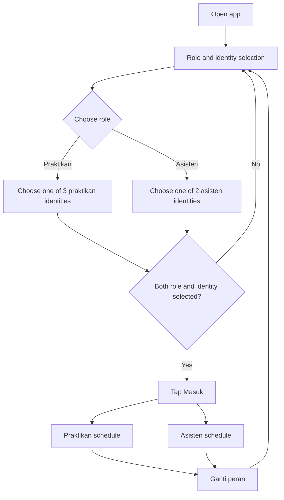
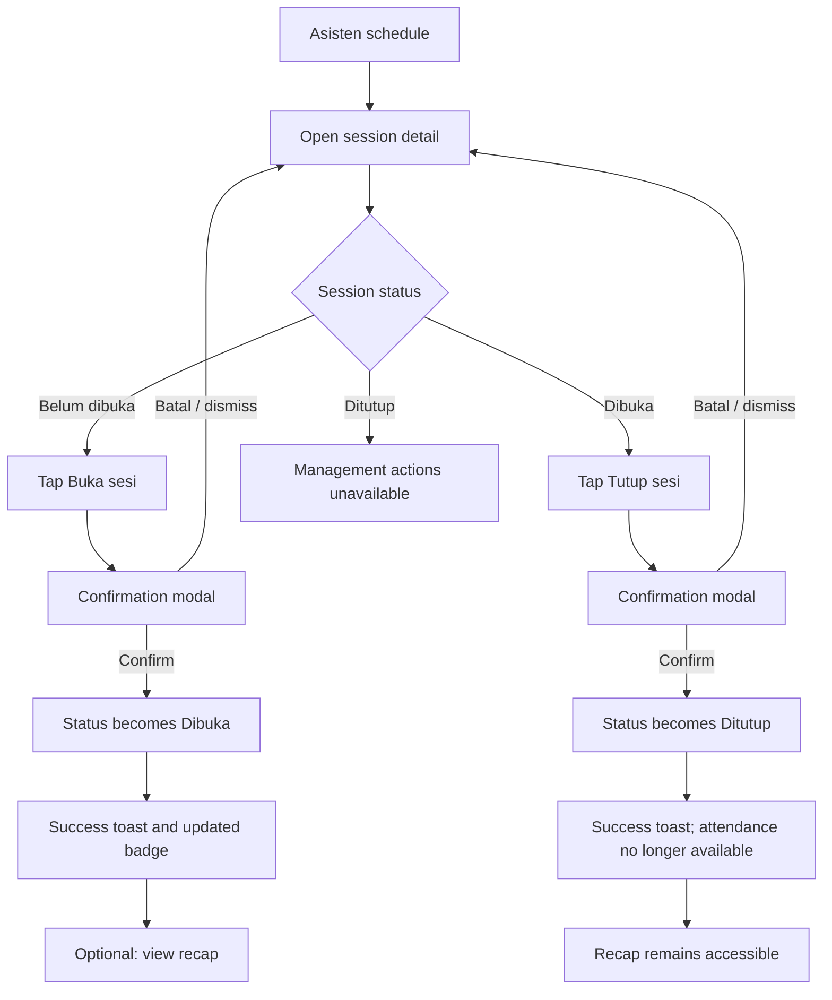
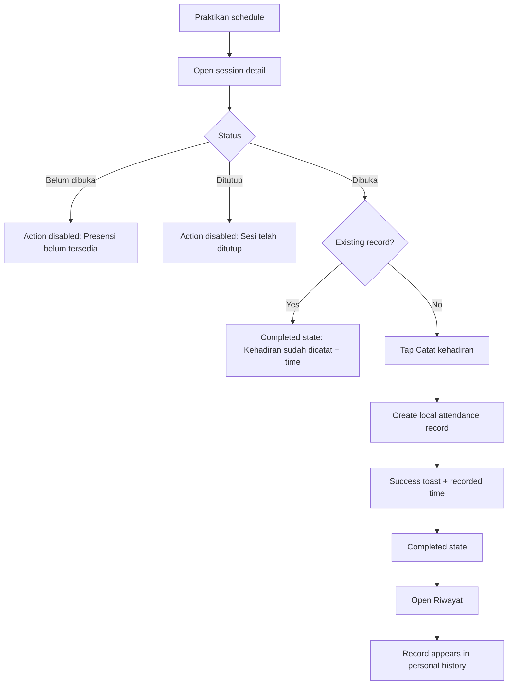

# Product Requirements Document — PrakPresensi

| Field | Value |
| --- | --- |
| Product | PrakPresensi (repository: `prak-ppk-mobile`) |
| Document version | 1.0 |
| Status | Implementation-ready specification |
| Platform | Expo / React Native (Android, iOS, web) |
| Scope | Frontend-only academic prototype |
| Source of truth | This document defines product behavior; `DESIGN.md` defines visual and interaction conventions |

---

## 6.1 Product Summary

### Product name

**PrakPresensi** — a mobile practicum attendance app for a university.

### Problem statement

Practicum attendance is often managed informally. Students do not have a clear view of when attendance is available, and assistants need a simple way to control the attendance window and inspect who has attended. For this academic project, the goal is not to replace an institutional system, but to demonstrate the complete intended experience in a small, understandable app.

### Product vision

A focused mobile utility where a praktikan can see the schedule, know whether a session is open, and record attendance in a few taps; and an asisten can open or close a session and review its attendance recap without leaving the app.

### Primary objective

Deliver a demonstrable, responsive, frontend-only React Native prototype with two roles, manual session status management, local attendance recording, duplicate prevention, and attendance recap/history.

### Target users

| User | Context | Main need |
| --- | --- | --- |
| **Praktikan** | A student attending a practicum session. | Know the schedule and session status, record attendance during an open session, and verify personal attendance history. |
| **Asisten** | A teaching assistant responsible for a practicum session. | Open/close attendance for a session and inspect the attendance recap. |
| **Evaluator/lecturer** | Reviews the app as an academic deliverable. | Follow a short, reliable demonstration of both roles without setup or backend infrastructure. |

### Success criteria

1. A new user can select a role and dummy identity and reach the relevant schedule in under one minute.
2. The assistant can open and close a session, with a confirmation step and immediately visible status change.
3. The praktikan can record attendance only while a session is open, sees a success confirmation and the recorded time, and cannot record a second time for the same session.
4. The assistant can open a recap and see the praktikan's name/identifier, status, and attendance time; an empty recap shows a clear empty state.
5. The praktikan can view personal attendance history and cannot see other students' records.
6. The main demonstration flow in §6.5 completes without errors, without a backend, and without restarting the app.
7. The UI passes the definition of done in §6.11 on a small phone screen (approximately 360 px wide) and a larger phone.

---

## 6.2 Goals and Non-Goals

### Goals

- Demonstrate the **full attendance workflow**: select identity → view session → open session → record attendance → verify recap/history → close session.
- Make session status unambiguous at all times.
- Use local dummy data and React state to simulate all behavior.
- Keep the codebase small enough for one developer to implement and explain.
- Reuse a small set of components and design tokens across both roles.
- Provide clear empty, disabled, success, and error states.

### Non-goals

- Backend APIs, databases, cloud functions, and real-time synchronization.
- Real authentication, authorization, passwords, SSO, or institutional account integration.
- Multi-device or cross-instance synchronization.
- Attendance rules based on real geolocation, biometrics, QR/NFC, or network checks.
- Student enrollment management, class administration, or assistant assignment workflows.
- Editing/deleting attendance records, reopening closed sessions, or an audit trail.
- Notifications, push messages, reminders, or calendar integration.
- Exporting, filtering, pagination, analytics, or reporting beyond a simple per-session recap.
- Dark/light theme switching UI beyond the system color scheme already handled by the starter app.
- Automated test infrastructure; verification is manual for this prototype.

### Priority principle

The required attendance workflow takes priority over optional polish. If time is limited, deliver every **Must Have** requirement in §6.4 before adding animation, icons, or extra copy.

---

## 6.3 User Stories

### Role and identity

| ID | User story |
| --- | --- |
| US-01 | As a user, I want to choose the **Praktikan** or **Asisten** role and a dummy identity so that I can experience the app from either perspective. |
| US-02 | As a demonstrator, I want to switch roles without restarting the app so that I can show both sides in one session. |

### Praktikan

| ID | User story |
| --- | --- |
| US-03 | As a praktikan, I want to view my practicum schedule so that I know when and where each session takes place. |
| US-04 | As a praktikan, I want to open a session detail so that I can see the class, time, room, assistant, and current status. |
| US-05 | As a praktikan, I want to record attendance during an open session so that my presence is documented. |
| US-06 | As a praktikan, I want clear feedback and the recorded time after attendance so that I know my action succeeded. |
| US-07 | As a praktikan, I want to be prevented from recording attendance twice for the same session so that my records stay accurate. |
| US-08 | As a praktikan, I want to view only my own attendance history so that I can verify my past records. |
| US-09 | As a praktikan, I want to understand why attendance is unavailable when a session is not open or is closed. |

### Asisten

| ID | User story |
| --- | --- |
| US-10 | As an asisten, I want to view upcoming and ongoing sessions so that I can manage the right session. |
| US-11 | As an asisten assigned to a practicum, I want to open its session after confirming so that attendance becomes available at the intended time. |
| US-12 | As an asisten assigned to a practicum, I want to close its session after confirming so that attendance is no longer accepted. |
| US-13 | As an asisten, I want to see the current status immediately after an action so that I can trust the interface. |
| US-14 | As an asisten, I want to view the attendance recap for a session so that I can inspect who attended and when. |
| US-15 | As an asisten, I want a clear empty recap state so that I can distinguish "no records" from a loading or broken screen. |

---

## 6.4 Functional Requirements

All requirements below are **Must Have** because they constitute the required demonstration. There are no Should/Could requirements that block the definition of done; optional polish is tracked separately in §6.10.

### FR-01 — Role and identity selection

| Field | Value |
| --- | --- |
| Role | Both |
| Priority | Must Have |

**Description.** The entry screen lets the user pick a role and one dummy identity for that role, then enter the app.

**Expected behavior**

- Show two clearly labeled role options: **Praktikan** and **Asisten**.
- After a role is selected, show the dummy identities for that role only.
- Show name, identifier (NIM/NIP-style), and class where relevant.
- The **Masuk** button is disabled until both a role and an identity are selected.
- On submit, store the active identity in local state and navigate to the selected role's schedule.
- The active identity is visible in the role home header (for example, the user's name).

**Acceptance criteria**

- [ ] On first launch, no role or identity is selected.
- [ ] Selecting **Praktikan** shows only the three praktikan identities; selecting **Asisten** shows only the two assistant identities.
- [ ] **Masuk** cannot be activated with a missing role or missing identity.
- [ ] If the user changes role after selecting an identity, the previous identity selection is cleared and the button is disabled until a new identity is chosen.
- [ ] Successful entry lands on the correct role's schedule screen, not on the other role's route.
- [ ] No password, email, or network request is required.

### FR-02 — Schedule list

| Field | Value |
| --- | --- |
| Roles | Praktikan, Asisten |
| Priority | Must Have |

**Description.** Both roles can view a list of practicum sessions.

**Expected behavior**

- Each list item shows practicum name, class, date, start and end time, room, and a labeled status badge.
- List items are ordered by session date/time, earliest upcoming first; past/closed sessions appear after upcoming/open sessions. A simple fixed order is acceptable.
- Tapping anywhere on an item opens its role-specific session detail.
- The screen shows the active user's name and role, plus an action to switch role.
- Praktikan has a visible entry point to **Riwayat** (personal attendance history).

**Acceptance criteria**

- [ ] The initial list contains the four seeded sessions from §6.7 with the specified statuses.
- [ ] Every item displays a status text label, not only a color.
- [ ] Tapping **Praktikum Pemrograman Mobile** opens `S-01`; each item opens its matching session.
- [ ] Long practicum names wrap or truncate gracefully without overlapping the status badge or time.
- [ ] If the dataset is empty, an empty state with the title **Belum ada jadwal** is shown.
- [ ] Switching role from this screen is possible without a restart.

### FR-03 — Session details

| Field | Value |
| --- | --- |
| Roles | Praktikan, Asisten |
| Priority | Must Have |

**Description.** A detail screen provides the information needed to understand and act on a session.

**Expected behavior**

- Show practicum name, class, date, start/end time, room, assistant name, and current status.
- Show status-specific guidance:
  - `upcoming` — **Belum dibuka**: attendance is not yet available.
  - `open` — **Dibuka**: attendance is available until the assistant closes the session.
  - `closed` — **Ditutup**: attendance is no longer available.
- Praktikan sees the attendance action and their existing attendance state for that session.
- Asisten sees **Buka sesi** for an upcoming session, **Tutup sesi** for an open session, and **Lihat rekap kehadiran** for any session.
- An invalid or unknown session ID shows a not-found state with a way back; the app must not crash.

**Acceptance criteria**

- [ ] All required fields are visible for `S-01` and match the data model.
- [ ] The status badge and guidance text change with the session status.
- [ ] Asisten action labels are correct for each status: open for upcoming, close for open, no open/close action for closed.
- [ ] Praktikan never sees session-management actions.
- [ ] `Lihat rekap kehadiran` is available to the asisten regardless of status, including a closed or empty session.
- [ ] Navigating to a nonexistent ID shows **Sesi tidak ditemukan** and does not crash.

### FR-04 — Open session

| Field | Value |
| --- | --- |
| Role | Asisten |
| Priority | Must Have |

**Description.** The assistant assigned to a practicum can open an upcoming session so attendance becomes available.

**Expected behavior**

- The **Buka sesi** action is available only when the active assistant is the assigned assistant for the session's practicum.
- The **Buka sesi** action opens a confirmation modal.
- The modal names the practicum and date and explains that attendance will become available.
- Confirming updates the session status from `upcoming` to `open`.
- Canceling leaves the status unchanged.
- After confirmation, the detail screen badge and action update immediately, and a success toast is shown.
- Opening a session records an `openedAt` display timestamp.
- The action is unavailable for an already-open or closed session, and the reducer rejects invalid transitions.
- An assistant who is not assigned to the practicum can still view the session and its recap but sees no **Buka sesi** action.

**Acceptance criteria**

- [ ] An unassigned assistant cannot open the session through the UI or reducer.
- [ ] Tapping **Buka sesi** does not change state until the user confirms.
- [ ] Canceling or dismissing the modal leaves the session as **Belum dibuka**.
- [ ] Confirming changes the badge to **Dibuka**, replaces the action with **Tutup sesi**, and shows a success message.
- [ ] The session remains open after navigating back to the list and reopening the detail.
- [ ] The transition is represented in React state, not faked by static per-screen copy.
- [ ] A closed session cannot be opened again in this prototype.

### FR-05 — Close session

| Field | Value |
| --- | --- |
| Role | Asisten |
| Priority | Must Have |

**Description.** The assistant assigned to a practicum can close an open session so attendance is no longer accepted.

**Expected behavior**

- The **Tutup sesi** action is available only when the active assistant is the assigned assistant for the session's practicum.
- The **Tutup sesi** action opens a confirmation modal.
- The modal names the session and warns that attendance will no longer be accepted.
- Confirming updates the status from `open` to `closed`, stores `closedAt`, and shows a success toast.
- Canceling leaves the session open.
- Existing attendance records remain intact and the recap remains accessible.
- After closure, the praktikan's attendance action becomes unavailable and the screen explains why.
- If the underlying status is no longer `open` when the confirmation is accepted, the action is rejected with an inline or toast error and the UI refreshes to the current status.
- An assistant who is not assigned to the practicum can still view the session and its recap but sees no **Tutup sesi** action.

**Acceptance criteria**

- [ ] An unassigned assistant cannot close the session through the UI or reducer.
- [ ] Tapping **Tutup sesi** does not change state until confirmation.
- [ ] Canceling or dismissing leaves the badge as **Dibuka**.
- [ ] Confirming changes the badge to **Ditutup**, removes the close action, and shows a success message.
- [ ] Existing attendance records remain visible in the recap after closing.
- [ ] A closed session cannot accept a new record through the UI or reducer.
- [ ] Reopening a closed session is not possible.

### FR-06 — Record attendance

| Field | Value |
| --- | --- |
| Role | Praktikan |
| Priority | Must Have |

**Description.** A praktikan can record attendance for a session only while it is open.

**Expected behavior**

- The primary attendance action is available only when all are true: active role is praktikan, session exists, session status is `open`, and no record exists for the active praktikan.
- Tapping **Catat kehadiran** records attendance using the active praktikan's identity and the current local time.
- The button shows a brief pending state and is disabled while saving.
- On success, a toast confirms attendance, the button changes to a completed/disabled state, and the recorded time is displayed on the same screen.
- The new record appears in the praktikan's history.
- No confirmation modal is required for attendance; the success feedback and completed state are sufficient.

**Acceptance criteria**

- [ ] With `S-01` open, Nabila Putri can tap **Catat kehadiran** once and succeeds.
- [ ] The success toast names the session or states **Kehadiran berhasil dicatat**.
- [ ] The recorded attendance time is visible immediately and persists while the app remains open.
- [ ] The new record appears in **Riwayat** without a reload.
- [ ] With a `upcoming` or `closed` session, the action is disabled and explanatory text is shown.
- [ ] Submitting while the data layer reports the session closed produces no attendance record and an error message.

### FR-07 — Prevent duplicate attendance

| Field | Value |
| --- | --- |
| Role | Praktikan |
| Priority | Must Have |

**Description.** One praktikan can have at most one attendance record per session.

**Expected behavior**

- Before rendering the action, the UI checks for an existing `(sessionId, praktikanId)` record.
- If a record exists, the action is replaced by a completed state: **Kehadiran sudah dicatat** with the time.
- The reducer independently rejects a duplicate write and leaves the existing record unchanged.
- The duplicate rule applies per praktikan, so different praktikans may each have one record for the same session.
- Switching to another praktikan identity and back does not remove an existing record during the same app run.

**Acceptance criteria**

- [ ] After Nabila records attendance for `S-01`, the attendance button is disabled and labeled as recorded.
- [ ] A second dispatch for the same session/praktikan does not create a second record.
- [ ] The attendance recap for `S-01` contains exactly one Nabila record.
- [ ] Bagas can still record attendance for the same session (once) if it is open.
- [ ] The duplicate rule remains true after navigating away and returning to the detail screen.

### FR-08 — Attendance recap

| Field | Value |
| --- | --- |
| Role | Asisten |
| Priority | Must Have |

**Description.** An assistant can inspect attendance records for a selected session.

**Expected behavior**

- The recap is reachable from the asisten session detail.
- It shows the practicum name, session date/time, and a list of attendance records.
- Each record shows the praktikan name, student identifier, status **Hadir**, and recorded time.
- The recap shows the number of recorded attendees (for example, **2 kehadiran tercatat**).
- If no attendance exists, show an empty state: **Belum ada kehadiran** with supporting text.
- The recap does not need filtering, sorting controls, pagination, or export.
- The recap remains available for open and closed sessions.
- The asisten only sees records for the selected session; praktikans cannot access this screen.

**Acceptance criteria**

- [ ] Opening the recap for `S-02` lists Bagas Saputra and Salsabila Rahma with times 10:06 and 10:11.
- [ ] Opening the recap for `S-03` lists three records including Nabila Putri at 13:04.
- [ ] Opening the recap for `S-01` before any attendance shows **Belum ada kehadiran**.
- [ ] After Nabila records attendance for `S-01`, the recap lists exactly one Nabila record with status **Hadir** and the recorded time.
- [ ] A closed session's recap is still reachable and shows the records.
- [ ] No other-student data appears in any praktikan screen.

### FR-09 — Personal attendance history

| Field | Value |
| --- | --- |
| Role | Praktikan |
| Priority | Must Have |

**Description.** A praktikan can view their own attendance records across sessions.

**Expected behavior**

- Accessible from the praktikan schedule header via **Riwayat**.
- Lists records belonging only to the active praktikan identity.
- Each item shows practicum name, session date, status **Hadir**, and the attendance time.
- Newest record appears first.
- The count of records is shown (for example, **2 kehadiran**).
- If the identity has no records, show **Belum ada riwayat kehadiran** with guidance.
- Switching praktikan identity shows that identity's records, not a merged view.

**Acceptance criteria**

- [ ] Nabila's initial history contains her `S-03` record at 13:04.
- [ ] Bagas's initial history contains `S-02` at 10:06 and `S-03` at 13:02.
- [ ] After attendance at `S-01`, Nabila's history contains three records with the new one first.
- [ ] No asisten or other praktikan controls are present.
- [ ] An identity with no records shows the empty state.
- [ ] The screen is not reachable from asisten-only routes.

### FR-10 — Confirmation and feedback interactions

| Field | Value |
| --- | --- |
| Roles | Both |
| Priority | Must Have |

**Description.** Important actions are confirmed, and the result of every action is communicated clearly.

**Expected behavior**

- **Open session** and **close session** always use a confirmation modal.
- Attendance does not require a confirmation modal but must show immediate success feedback.
- Success feedback uses an in-app toast or inline success state, not only an OS alert.
- The modal can be dismissed with **Batal**, the backdrop, and the Android back button. The destructive/primary confirm action is clearly labeled.
- While an action is pending, the confirm button is disabled to prevent double submission.
- If an invalid transition occurs, the user sees an error message and the UI reflects the actual current state.
- Status and attendance changes are visible without a manual refresh.
- A status is never communicated by color alone; badges include text.

**Acceptance criteria**

- [ ] Open and close each present a modal naming the session.
- [ ] Canceling leaves state unchanged; confirming changes it exactly once.
- [ ] Attendance shows **Kehadiran berhasil dicatat** or equivalent toast/banner and the completed button state.
- [ ] An error is shown if the user attempts an attendance action while the session is closed.
- [ ] Double-tapping a confirm action cannot create two state transitions or two attendance records.
- [ ] Every status badge includes readable text as well as a color.

---

## 6.5 User Flows

### Flow A — Role and identity selection



### Flow B — Assistant opens and closes a session



### Flow C — Praktikan records attendance and verifies history



### Flow D — End-to-end demonstration

```mermaid
flowchart LR
    A[Select Asisten Raka] --> B[Open S-01 session detail]
    B --> C[Confirm Buka sesi]
    C --> D[Status Dibuka]
    D --> E[Switch to Praktikan Nabila]
    E --> F[Open S-01]
    F --> G[Catat kehadiran]
    G --> H[Toast + time + completed state]
    H --> I[Riwayat shows record]
    I --> J[Switch back to Asisten Raka]
    J --> K[Open S-01 recap]
    K --> L[Recap shows Nabila Hadir]
    L --> M[Confirm Tutup sesi]
    M --> N[Status Ditutup]
    N --> O[Switch to Praktikan: action disabled]
```



All role changes happen in the same running app. The shared session/attendance data is in-memory React state and resets on reload; it is not backend synchronization.

---

## 6.6 Screen Inventory

| # | Screen / component | Purpose | Role | Main content | Primary action | Secondary interactions |
| --- | --- | --- | --- | --- | --- | --- |
| 1 | **Role and identity selection** (`/`) | Choose a role and dummy user. | Both | App name, two role cards, identity list, inline demo note. | **Masuk** | Change role; select identity; read note that data is local. |
| 2 | **Praktikan schedule** (`/praktikan`) | Browse practicum sessions. | Praktikan | User greeting, count, session list with status, room/time, status legend. | Open a session. | **Riwayat**; **Ganti peran**. |
| 3 | **Praktikan session detail** (`/praktikan/session/[sessionId]`) | Understand a session and record attendance. | Praktikan | Session title, status, date/time, room, assistant, guidance, attendance state. | **Catat kehadiran** (only when open and not recorded). | Read guidance; see recorded time; go back. |
| 4 | **Praktikan attendance history** (`/praktikan/history`) | View own attendance records. | Praktikan | Count, record list, empty state. | Open a related session detail. | Go back to schedule. |
| 5 | **Asisten schedule** (`/asisten`) | Browse sessions; manage assigned ones. | Asisten | User greeting, session list with status, room/time, status legend. | Open a session. | **Ganti peran**. |
| 6 | **Asisten session detail** (`/asisten/session/[sessionId]`) | Manage assigned session status and access recap. | Asisten | Session title, status, metadata, status explanation, management actions or assignment notice. | **Buka sesi** or **Tutup sesi** when assigned. | **Lihat rekap kehadiran**; back. |
| 7 | **Attendance recap** (`/asisten/session/[sessionId]/recap`) | Inspect attendance for one session. | Asisten | Session identity, attendee count, record list, empty state. | Back to session detail. | View individual attendance times. |
| 8 | **Confirmation modal** (overlay) | Confirm opening or closing. | Asisten | Title, session name, consequence text, **Batal** / confirm. | Confirm. | Cancel, backdrop dismiss, back dismiss. |
| 9 | **Success toast / banner** (overlay) | Confirm the result of an action. | Both | Short message; auto-dismiss. | Dismiss (optional). | Accessibility announcement. |
| 10 | **Not-found state** (within session route) | Handle invalid session IDs. | Both | **Sesi tidak ditemukan**, explanation, back action. | Back to schedule. | Role switch remains available. |

The informational bottom sheet is a reusable component specified in `DESIGN.md`, but no separate screen is required. Session details are a full screen; modals are used only for confirmation.

---

## 6.7 State and Data Model

This is a **presentation/local-state model only**. It is not a backend schema, does not require persistence, and may live entirely in memory.

### Type definitions

```ts
type UserRole = 'praktikan' | 'asisten';
type SessionStatus = 'upcoming' | 'open' | 'closed';
type AttendanceStatus = 'present';

interface DemoUser {
  id: string;
  role: UserRole;
  name: string;
  identifier: string;   // NIM for praktikan, NIP-style ID for asisten
  className?: string;   // e.g. "IF-3A"
}

interface Practicum {
  id: string;
  name: string;
  className: string;
  assistantId: string;
}

interface Session {
  id: string;
  practicumId: string;
  date: string;         // display date, e.g. "2026-10-26"
  startTime: string;    // "08:00"
  endTime: string;      // "09:40"
  room: string;
  status: SessionStatus;
  openedAt?: string;    // display timestamp
  closedAt?: string;    // display timestamp
}

interface AttendanceRecord {
  id: string;
  sessionId: string;
  praktikanId: string;
  status: AttendanceStatus;
  recordedAt: string;   // display time, e.g. "08:42"
}

interface DemoState {
  activeRole: UserRole | null;
  activeUserId: string | null;
  users: DemoUser[];
  practicums: Practicum[];
  sessions: Session[];
  attendanceRecords: AttendanceRecord[];
}
```

### Dummy users

| ID | Role | Name | Identifier | Class |
| --- | --- | --- | --- | --- |
| `P-01` | Praktikan | Nabila Putri | `2211102034` | IF-3A |
| `P-02` | Praktikan | Bagas Saputra | `2211102041` | IF-3A |
| `P-03` | Praktikan | Salsabila Rahma | `2211102052` | IF-3A |
| `A-01` | Asisten | Raka Pratama | `2211101008` | — |
| `A-02` | Asisten | Dinda Maharani | `2211101015` | — |

### Dummy sessions

| ID | Practicum | Class | Date | Time | Room | Assistant | Initial status |
| --- | --- | --- | --- | --- | --- | --- | --- |
| `S-01` | Praktikum Pemrograman Mobile | IF-3A | Senin, 26 Okt 2026 | 08:00–09:40 | Lab Mobile 2 | `A-01` | `upcoming` — Belum dibuka |
| `S-02` | Praktikum Basis Data | IF-3A | Selasa, 27 Okt 2026 | 10:00–11:40 | Lab Basis Data 1 | `A-02` | `open` — Dibuka |
| `S-03` | Praktikum Jaringan Komputer | IF-3A | Senin, 19 Okt 2026 | 13:00–14:40 | Lab Jaringan | `A-01` | `closed` — Ditutup |
| `S-04` | Praktikum Struktur Data | IF-3A | Rabu, 28 Okt 2026 | 15:00–16:40 | Lab Komputer 3 | `A-02` | `upcoming` — Belum dibuka |

### Seeded attendance

| Session | Praktikan | Status | Recorded time |
| --- | --- | --- | --- |
| `S-02` | Bagas Saputra (`P-02`) | Hadir | 10:06 |
| `S-02` | Salsabila Rahma (`P-03`) | Hadir | 10:11 |
| `S-03` | Nabila Putri (`P-01`) | Hadir | 13:04 |
| `S-03` | Bagas Saputra (`P-02`) | Hadir | 13:02 |
| `S-03` | Salsabila Rahma (`P-03`) | Hadir | 13:09 |

### Session states

| Internal status | UI label | Meaning | Attendance available? | Asisten action |
| --- | --- | --- | --- | --- |
| `upcoming` | **Belum dibuka** | The session exists but attendance has not been opened. | No | **Buka sesi** |
| `open` | **Dibuka** | Attendance is currently accepted. | Yes, if no record exists | **Tutup sesi** |
| `closed` | **Ditutup** | Attendance is no longer accepted. | No | No open/close action; recap remains available |

Valid transitions in this prototype:

```
upcoming --open--> open --close--> closed
```

No other transitions are allowed. `closed` cannot return to `open`. Statuses are explicit display/behavior states and are **not** computed from the current clock. The dates are dummy values even if they are in the past or future relative to the demo day.

### State ownership

| State | Owner | Scope |
| --- | --- | --- |
| Active role and identity | Demo data provider (`useReducer`/Context) | Global for the running app; changed by role selection or **Ganti peran**. |
| Users, practicums, sessions, attendance records | Demo data provider | Shared by both role routes in the same app instance. |
| Selected role and identity on the entry form | Role selection screen | Local until **Masuk** is pressed. |
| Confirmation modal visibility and action kind | Session detail screen | Local UI state. |
| Pending/saving flag | Session detail screen | Local UI state; prevents double submission. |
| Toast visibility/message | Screen or small global feedback context | Local UI state; auto-dismisses. |
| Scroll position and route stack | Navigation | Standard Expo Router behavior. |

### Role state clarification

- The two roles do **not** have separate backends. In this prototype they read the same in-memory store so the main demonstration can show an assistant's action affecting the praktikan view within one app run.
- This is **local UI state sharing**, not synchronization. There is no persistence, polling, websocket, server, or multi-device behavior.
- Restarting the app restores the seed state.
- Access control is presentational: routes and actions are hidden/disabled by role. This is not real authorization.

### Data actions and guards

| Action | Guard | Result |
| --- | --- | --- |
| `selectIdentity(role, userId)` | User exists, role matches | Set active role and user; navigate to role home. |
| `switchRole(role, userId)` | Same as above | Replace active identity; do not reset data. |
| `openSession(sessionId, at)` | Active role is asisten; active user is the assigned assistant; session exists; status is `upcoming` | Status becomes `open`, set `openedAt`. |
| `closeSession(sessionId, at)` | Active role is asisten; active user is the assigned assistant; session exists; status is `open` | Status becomes `closed`, set `closedAt`; keep records. |
| `recordAttendance(sessionId, praktikanId, at)` | Active user is that praktikan; session exists; status is `open`; no existing `(sessionId, praktikanId)` | Append one record with status `present`. |
| `getAttendanceForSession(sessionId)` | Read-only | Records for that session, ordered by recorded time. |
| `getAttendanceForPraktikan(praktikanId)` | Read-only | That praktikan's records, newest first. |

### Duplicate attendance rule

Attendance uses a composite logical key:

```
sessionId + praktikanId
```

- The detail screen derives the button state from the presence of that key.
- The reducer checks the key again before appending.
- A duplicate attempt is a no-op and does not change the existing time.
- Different praktikan IDs can record for the same open session.
- The rule is sufficient for a single-user prototype; there is no concurrency handling beyond the reducer's synchronous guard.

---

## 6.8 Edge Cases and Empty States

| Scenario | Expected behavior |
| --- | --- |
| No schedules exist | Show **Belum ada jadwal** with supporting text. Do not show an empty white screen or a loading spinner forever. |
| Session not opened (`upcoming`) | Show **Belum dibuka** and guidance that the asisten has not opened attendance. Praktikan action is disabled. Asisten pengampu sees **Buka sesi**. |
| Session already open | Show **Dibuka**. Asisten pengampu sees **Tutup sesi**, not another open action. Praktikan may attend if not yet recorded. |
| Session closed | Show **Ditutup** and state that attendance is unavailable. Praktikan action disabled. Asisten pengampu sees no open/close action; all asisten can view the recap. |
| Asisten bukan pengampu | Show the session and recap read-only. Hide **Buka sesi** and **Tutup sesi**; explain which assistant is assigned. The reducer also rejects management actions. |
| Attendance already recorded | Replace the action with **Kehadiran sudah dicatat** and the recorded time. The button is disabled. A second write is rejected. |
| Session closes while praktikan has the detail open | On action, the reducer rejects the write; show an error toast/banner and refresh the status. Because this is a single-user local prototype, this is an unlikely but defined behavior. |
| Attendance recap is empty | Show **Belum ada kehadiran** with text such as "Kehadiran yang dicatat akan muncul di sini." Keep the session header visible. |
| Attendance history is empty | Show **Belum ada riwayat kehadiran** with guidance to attend an open session. |
| User switches role/identity | Close any open modal or toast, preserve the demo data, navigate to the new role's schedule. Do not carry configuration screens across roles. |
| Form missing or invalid selection | Keep **Masuk** disabled. Show a small inline validation message if the user attempts to submit. No crash, no navigation. |
| Active identity is lost (deep link/refresh) | Redirect to the role selection screen. Do not render role screens with a null identity. |
| Unknown `sessionId` | Show **Sesi tidak ditemukan** and a **Kembali ke jadwal** action. |
| Long practicum name | Wrap to a maximum of two lines or truncate with ellipsis; never push the badge off screen or overlap the date. Use flexible widths and `numberOfLines`. |
| Long student name | Allow two lines in recap/history; keep NIM/time readable. |
| Small screen (about 360 px) | Cards use full width; no horizontal scrolling; time and badge remain visible; buttons stretch but respect 44 px minimum touch height. |
| Large text / accessibility font scaling | Text may wrap; avoid fixed text containers; primary actions remain reachable by scrolling. |
| Keyboard visible on the entry form | The form remains scrollable and the submit button is not hidden; safe areas are respected. |
| User double-taps confirm | Pending state disables the button; only one transition is applied. |
| Role mismatch on a route | Redirect to the correct role home or role selection. Do not expose asisten controls to a praktikan. |

---

## 6.9 Non-Functional Requirements

| ID | Requirement | Acceptance criteria |
| --- | --- | --- |
| NFR-01 | Responsive mobile layout | Layout uses Flexbox, fills the screen, works at 360 px width and larger, respects safe areas, and avoids fixed-width containers. Long content wraps without overlap or horizontal scrolling. |
| NFR-02 | Accessibility and contrast | Body text and essential labels meet readable contrast (target WCAG AA, 4.5:1 for normal text). Touch targets are at least 44×44 px. Status includes a text label. Buttons expose accessible roles/labels and disabled state. |
| NFR-03 | Clear feedback | Every action has a visible result: status change, pending state, success toast/banner, or inline error. No action ends with silent uncertainty. |
| NFR-04 | Consistent navigation | Both roles use the same navigation model. Back returns to the previous screen. Role switching is available from role screens. No dead ends. |
| NFR-05 | Maintainable component structure | Shared components live outside `src/app/`; screens compose shared components. No copy-pasted duplicate button/card implementations across roles. |
| NFR-06 | Minimal dependencies | No backend/API/database, no state-management library, no UI kit, and no new dependency unless already justified and approved. Use React Native core, Expo Router, and installed Expo modules. |
| NFR-07 | Predictable local state | Reducer guards invalid session transitions and duplicate attendance. State changes are synchronous from the user's perspective. Reloading restores seed data deterministically. |
| NFR-08 | Performance | The small list (four sessions, a handful of records) renders without noticeable delay. Avoid unnecessary re-renders and heavy animation. |
| NFR-09 | Cross-platform behavior | Android, iOS, and web targets remain usable. Use platform-safe APIs and avoid iOS-only symbols without fallbacks or text labels. |
| NFR-10 | Type safety | TypeScript strict mode passes with no errors. Domain types are shared between data, store, and screens. |
| NFR-11 | Honest prototype behavior | No screen claims real authentication, persistence, notifications, or cross-device synchronization. Demo data resets on reload and this is documented. |

---

## 6.10 Scope and Prioritization

One developer owns the whole implementation. The order below is a dependency-aware sequence, not a multi-team sprint plan.

| Step | Work | Outcome | Required? |
| --- | --- | --- | --- |
| 1 | App foundation, navigation, role/identity selection | A user can enter either role and switch later. Shared types, tokens, and demo provider skeleton exist. | Must |
| 2 | Schedule list and session detail for both roles | All seeded sessions are browsable with correct status labels and metadata. | Must |
| 3 | Assistant session management | Open/close with confirmation; status updates in state; recap entry point. | Must |
| 4 | Praktikan attendance and history | Attendance action, success feedback, recorded time, duplicate prevention, personal history. | Must |
| 5 | Attendance recap | Per-session records, count, and empty state for asisten. | Must |
| 6 | Polish, empty states, and manual testing | Long-content handling, accessibility, keyboard/safe-area checks, edge cases, typecheck/lint. | Must before demo |

Optional polish only after the required workflow works:

- Subtle press/opacity feedback and short fade transitions.
- Status legend on schedule screens.
- Info bottom sheet for extra session notes.
- Dark mode token verification (the starter already supports system color scheme).

Do not add: authentication, filtering, export, analytics, notification systems, or backend integration.

---

## 6.11 Definition of Done

The application is ready to demonstrate when all items below are true.

### Functional checks

- [ ] **Role selection:** **Masuk** is disabled until role + identity are chosen; each role opens its own schedule.
- [ ] **Role switching:** **Ganti peran** returns to selection, and a new identity can enter without restarting; attendance/session data persists within the run.
- [ ] **Schedule:** four seeded sessions appear with name, class, date, time, room, and text status; tapping opens the matching detail.
- [ ] **Session detail:** metadata and status guidance are correct for `upcoming`, `open`, and `closed`; unknown IDs show the not-found state.
- [ ] **Open flow:** **Buka sesi** requires confirmation; cancel changes nothing; confirm changes `S-01` to **Dibuka**, updates the action, and shows success feedback.
- [ ] **Attendance success:** with `S-01` open, Nabila can record attendance once; time is visible; a toast/banner confirms success.
- [ ] **Duplicate protection:** the attendance action becomes a disabled completed state; no second record exists in history or recap; the reducer guard is present.
- [ ] **Attendance availability:** an upcoming or closed session shows a disabled action with an explanation; attempting a write through the store is rejected.
- [ ] **Recap:** asisten can open the recap for `S-02`/`S-03` and see names, identifiers, **Hadir**, and times; `S-01` initially shows **Belum ada kehadiran**; after attendance it shows one record.
- [ ] **History:** Nabila sees only her records; new attendance appears at the top; another praktikan sees different records.
- [ ] **Close flow:** **Tutup sesi** requires confirmation; cancel changes nothing; confirm changes the status to **Ditutup**, preserves records, and makes praktikan attendance unavailable.
- [ ] **Feedback:** open, close, attendance, and errors each produce visible feedback; no duplicate dispatch from double taps.
- [ ] **Role boundaries:** asisten cannot record attendance; praktikan cannot open/close or access recap; only the assigned assistant can open or close a session; no other student's history is visible.
- [ ] **Empty/edge states:** invalid selection, unknown session, empty recap, empty history, and long content all behave as specified in §6.8.

### Technical checks

- [ ] `npx tsc --noEmit` passes.
- [ ] `npm run lint` passes, or any pre-existing Expo lint setup limitation is documented.
- [ ] No unhandled promise rejections, red screen errors, or console errors during the primary flow.
- [ ] No backend, database, network request, or new unnecessary dependency is introduced.
- [ ] Design tokens and shared components are used instead of scattered raw values and duplicated role-specific components.
- [ ] The app runs on Android (emulator or device) and web; iOS is validated when a macOS environment is available.
- [ ] Safe areas, keyboard behavior, and scrolling are checked on a small screen.
- [ ] README commands match the repository and the documented demo steps work with the implemented app.

### Demo readiness

- [ ] The main flow in §6.5 completes in one running app instance without developer tools.
- [ ] The demo can be repeated by reloading the app to restore seed data.
- [ ] The presenter can explain which behavior is real local state and which is simulated dummy data.

---

## Assumptions

These assumptions are part of this PRD and should be referenced when implementing:

1. All dummy praktikans are considered enrolled in all listed sessions; there is no enrollment model or class filtering.
2. Dates and times are static display data. Session status is manual, not clock-derived.
3. Attendance has one status, **Hadir**. Absence, permission, and late statuses are out of scope.
4. Attendance time uses the device's local time and is displayed as `HH:mm` (WIB context, no timezone conversion).
5. Both roles share one in-memory demo store during a single app run. This is not persistent or cross-device synchronization.
6. The app is a single-user demonstration: there is no concurrent user simulation, optimistic update, or conflict resolution.
7. The planned UI language is Indonesian; code identifiers and documentation are in English.
8. The existing Expo starter screens and native tab layout will be replaced by the routes described here and in `DESIGN.md`.
